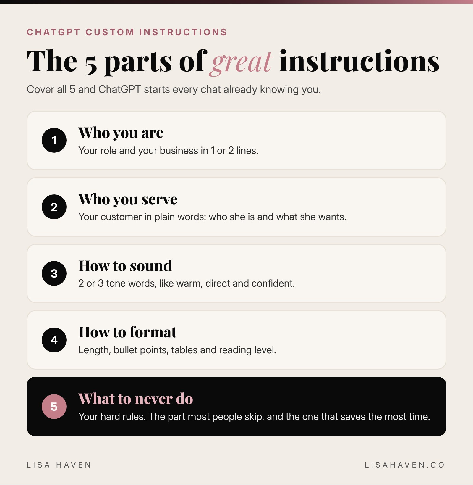

I work in pieces. 10 minutes on an email, then my toddler needs me. 15 minutes on a plan for VIXA, then a school pickup. When I sit back down, the last thing I want is to explain myself to my AI all over again.

So I stopped. Here is the short answer: **ChatGPT custom instructions are a short set of standing rules that tell ChatGPT who you are and how you want it to answer.** You write them once in your settings, and ChatGPT follows them in every chat. No more retyping "keep it short" or "I run a small business" 20 times a week.

Below is exactly how to turn them on, what to write, and the fill in the blank template I would hand any founder.

## What are ChatGPT custom instructions?

Think of custom instructions as a sticky note on ChatGPT's desk. Every time you start a chat, it reads the note first.

A good note answers 2 questions:

- **Who am I?** Your role, your business, your customers and what you are working on.
- **How should you answer me?** Your tone, the length you like, the format and the things you never want.

Without that note, ChatGPT treats you like a stranger. It guesses. And when AI guesses, you get the most average answer on the internet. With the note, it starts every chat already knowing you.

Here is something most people do not know. According to [OpenAI's own help page](https://help.openai.com/en/articles/8096356-chatgpt-custom-instructions), changes to your custom instructions apply right away across all your chats, including conversations you already started. Free and Go users can save up to 1,500 characters. Plus, Pro, Business, Enterprise and Education users get up to 5,000. That is room for a whole playbook.

## How to turn on custom instructions in ChatGPT

It takes about 2 minutes. These steps come straight from OpenAI's help page.

**On a computer (web or desktop app):**

1. Click your profile picture and open **Settings**.
2. Select **Personalization**.
3. Make sure **Enable customization** is turned on.
4. Type your rules into the **Custom Instructions** field and save.

**On your phone (iPhone or Android):**

1. Open **Settings**.
2. Tap **Customize ChatGPT**.
3. Turn on **Enable customization**.
4. Add your rules in the **Custom Instructions** field.

Custom instructions work on every plan, including the free one. If you ever want a clean, "no rules" chat, just toggle customization off for a moment.

## The 5 parts of great ChatGPT custom instructions

The best custom instructions cover the same 5 things. Miss 1, and the answers start to drift.



1. **Who you are.** Your role and your business in 1 or 2 lines. "I am the founder of a skincare brand" beats "I am an entrepreneur."
2. **Who you serve.** Your customer, in plain words. This changes every marketing answer you get.
3. **How to sound.** Warm, direct, playful, formal. Pick 2 or 3 words and stop there.
4. **How to format.** Short paragraphs, bullet points, tables, word count, reading level.
5. **What to never do.** Your hard rules. This is the part most people skip, and it is the part that saves the most time.

## My ChatGPT custom instructions template for founders

Here is a template you can copy. Fill in the brackets, paste it into the Custom Instructions field, and save. It fits inside the 1,500 character free limit.

```prompt
ABOUT ME
I am the [founder / CEO / owner] of [business name], a [what you sell] for [who you sell to]. Right now I am focused on [your top goal this quarter]. I am a [mom of 2 / busy professional / solo founder], so my time comes in short blocks.

MY CUSTOMER
My customer is [describe her in 1 sentence: age, problem, what she wants].

HOW TO ANSWER ME
- Be direct. Give me the answer first, then the details.
- Keep it short unless I ask for more.
- Write at a 6th to 8th grade reading level.
- Use short paragraphs and bullet points.
- Write numbers as numerals.
- When you write in my voice, sound [warm / confident / playful], never stiff.

NEVER DO THIS
- Never use em dashes.
- Never use filler phrases like "great question" or "let's dive in."
- Never make up facts, stats or quotes. If you are not sure, say so.
- Do not use abbreviations without spelling them out first.

WHEN IN DOUBT
Ask me 1 clear question before a big task instead of guessing.
```

The last line is my favorite. 1 question up front beats 3 rounds of fixing a wrong answer.

These rules are not made up for this post. They are the same standing rules I give my own AI tools: short answers, everyday words, numbers as numerals, no em dashes, and check the facts twice. Once I wrote them down, I stopped repeating myself, and every draft came back closer to how I actually talk.

## Before and after: what changes

Here is a simple example of the difference. Say you type this into ChatGPT:

*"Write an Instagram caption for my new product."*

**Without custom instructions,** ChatGPT does not know your product, your customer or your voice. You usually get something long and generic, packed with hashtags, words like "elevate" and "unleash," and a tone that sounds like a press release.

**With custom instructions,** ChatGPT already knows you sell to busy women, that you like short sentences and everyday words, and that you never want filler. Now the first draft is short, sounds like you, and only needs a small edit.

Same question. Same tool. Completely different starting point. That is the whole power of custom instructions: **you stop fixing the first draft and start approving it.**

## Custom instructions examples for different jobs

Your instructions should match the work you do most. Here are 3 quick swaps for the "How to answer me" section.

| If you mostly use ChatGPT for... | Add this line |
|---|---|
| Social posts and captions | "Write like a real woman talking to her friend. Give me 3 options with different hooks." |
| Customer emails | "Keep emails under 120 words. Friendly, clear and always end with 1 next step." |
| Planning and strategy | "Give me a short plan with numbered steps, owners and a deadline for each step." |

Pick the 1 that fits your week and add it. You can always change it later. You can also save short codes here, like /SOP or /CAPTION. Here are [30 ChatGPT codes for business](https://lisahaven.co/blog/chatgpt-codes/) you can copy.

If you want to go deeper on getting great answers inside each chat, read my guide on [how to ask ChatGPT a question and get a great answer](https://lisahaven.co/blog/how-to-ask-chatgpt-better-questions/). Custom instructions set the stage. A good question does the rest.

## 4 mistakes that make custom instructions backfire

**1. Writing a novel.** More is not always better. If your rules contradict each other ("be detailed" and "keep it short"), ChatGPT has to pick 1. Keep every line clear and specific.

**2. Using vague words.** "Be professional" means 100 different things. "Write like a confident founder emailing a new partner" means 1 thing.

**3. Forgetting to update it.** Your goals change every quarter. Your instructions should too. Give them a quick look at the start of each month.

**4. Sharing private details.** Custom instructions are saved to your account. Keep out passwords, account numbers, your home address and anything about your kids you would not post publicly. OpenAI's help page also notes that information from custom instructions can be used to improve its models unless you opt out in your data controls, so treat it like a public bio, not a diary.

## Custom instructions vs memory vs projects

ChatGPT has 3 ways to "remember" you, and people mix them up all the time.

| Feature | What it does | Best for |
|---|---|---|
| Custom instructions | Rules ChatGPT follows in every chat | Your role, tone and hard rules |
| Memory | Details ChatGPT saves from your chats over time | Small facts, like your kids' activities or your favorite tools |
| Projects | Folders that keep chats and files together | 1 big job, like a launch or a client |

My simple rule: **custom instructions are for how you want to be treated. Memory is for small facts. Projects are for 1 big job.** Want to go deeper on the memory part? Here is [how I use ChatGPT memory, and what I never let it keep](/blog/chatgpt-memory/). If you want to see how ChatGPT compares to my other favorite tool for this, read [Claude vs ChatGPT for business](https://lisahaven.co/blog/claude-vs-chatgpt/).

## Tools I use for this

*Some links in this post may be affiliate links, which means I may earn a small commission at no extra cost to you. I only share tools I really use.*

- **[ChatGPT](https://chatgpt.com):** custom instructions work on the free plan. Paid plans give you more room to write.
- **[Claude](https://claude.ai):** my go to for long writing and planning. It has its own version of standing instructions in its settings, so the template above works there too.
- **[Notion](https://www.notion.com):** where I keep a master copy of my instructions, so I can paste them into any AI tool in 10 seconds.

## Your next step

Set aside 10 minutes tonight. Copy the template, fill in the brackets, and save it. Then ask ChatGPT the same question you asked yesterday and compare the answers. You will feel the difference right away.

**Want prompts written for the way women think?** [LUMAPROMPT.AI](https://www.lumaprompt.ai/?ref=blog-chatgpt-custom-instructions) is my library of prompts written by real human experts, for your business, your home and your family. They work in ChatGPT and Claude.

## FAQ

**Are ChatGPT custom instructions free?**
Yes. Custom instructions are available on every ChatGPT plan, including the free one. Free and Go users can save up to 1,500 characters, and paid plans can save up to 5,000.

**Do custom instructions apply to old chats?**
Yes. According to OpenAI, changes apply right away across all your chats, including ones you already started. If you want a chat with no rules, turn customization off for a moment.

**What is the difference between custom instructions and memory?**
Custom instructions are rules you write on purpose, like your tone and format. Memory is small details ChatGPT saves from your chats over time. Use instructions for how you want to be treated and memory for small facts.

## Before you go

Quick poll for the comments: **do you already use custom instructions?** Reply with A for "yes, every day," B for "I set them up once and forgot," or C for "starting tonight." And if you have 1 rule that changed everything for you, share it. I read every comment.

## Keep reading

- [30 ChatGPT Codes for Business (Copy and Paste)](/blog/chatgpt-codes/)
- [How to Ask ChatGPT a Question (and Get a Great Answer)](/blog/how-to-ask-chatgpt-better-questions/)
- [ChatGPT Prompts for Busy Moms: 10 That Actually Work](/blog/chatgpt-prompts-for-busy-moms/)
- [How to Use AI Without Sounding Like AI](/blog/how-to-use-ai-without-sounding-like-ai/)

> "Small daily improvements over time lead to stunning results." Robin Sharma
