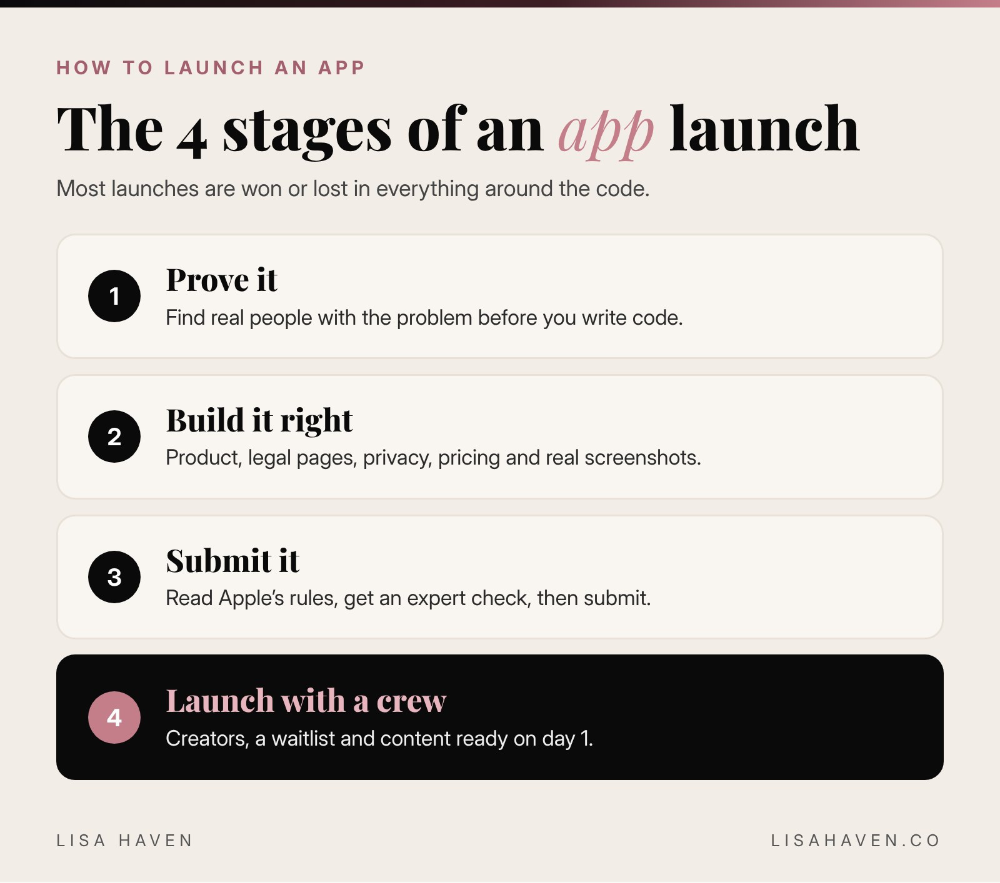

I have a group of creators in my Discord, ready to post about VIXA the day it goes live on the App Store. I have a website, a free tool women are already using, legal pages written by an attorney, and a launch checklist on a monday.com board. I also have more than 1 App Store rejection behind me.

So when people ask me how to launch an app, I don't give them the pretty version. Here is the short answer: **to launch an app, prove people want it, build your launch crew before launch day, read Apple's rules before you submit, and run every step from 1 checklist.** The code matters. But most launches are won or lost in everything around the code.

Here are the 7 lessons I'm learning while launching VIXA, my dating clarity app for women, written in the middle of it.

**Key takeaways**

- Validate the problem with real people before you build.
- Write your privacy policy and terms early, not the week you submit.
- Read Apple's App Review Guidelines yourself. Word choice can get you rejected.
- Build your launch team (creators, a waitlist, a free tool) before launch day.
- Get an expert's eyes on your submission before you resubmit.
- Use AI to run the checklist so nothing falls through.

## How to launch an app: the 4 stages nobody explains

Most "how to launch an app" guides start with code and end with a press release. Real launches have 4 stages, and each one has its own work.



1. **Prove it.** Make sure the problem is real before anyone writes code.
2. **Build it right.** Product, legal pages, privacy, pricing and screenshots.
3. **Submit it.** Apple's review, fixes and resubmissions.
4. **Launch it with a crew.** Creators, content and a waitlist ready on day 1.

Here is what I learned in each stage.

## Lesson 1: Prove people want it before you build it

Before VIXA was an app, it was a question I kept seeing over and over: women posting screenshots of texts and asking strangers, "What does this mean?"

So I went where those women already were. I read Reddit posts where women share screenshots of confusing texts and ask for help. I didn't pay for ads or run fancy surveys. I just read what real women were asking, in their own words.

That did 2 things. It proved the problem was real, and it gave me the exact words my future customers use. Those words now live in my headlines, my website and my blog. If you want the full story of why I built VIXA, read [what VIXA is and why I built it](https://lisahaven.co/blog/what-is-vixa/).

**Do this:** Find 20 real posts, reviews or comments where people describe the problem your app solves. If you can't find 20, slow down.

## Lesson 2: Write your legal pages early

This is the part founders skip, and it's the part that slows you down at the end.

Your app needs a privacy policy and terms of service before Apple will approve it. If your app handles anything personal, like VIXA does with text screenshots, those pages need to match exactly what your app does with data.

I worked with an attorney on mine, and my developer reviewed the privacy policy line by line so it matched how the app really works. It took weeks of back and forth. I'm so glad we started early.

**Do this:** Write down every type of data your app collects, where it's stored and how long you keep it. Hand that list to your attorney. It saves time and money.

## Lesson 3: Read Apple's rules yourself, word by word

My first submission taught me something no tutorial did: **words matter.**

Inside VIXA, I used the phrases "red flags" and "green flags." Women say those words every day. But Apple's reviewers felt the language was a problem, and I had to change it. Today those features are called **Vixa Signals** and **Vixa Watch**, and honestly, I like the new names better. They feel more like us.

Every rejection message points to a guideline number. Read the full section in Apple's [App Review Guidelines](https://developer.apple.com/app-store/review/guidelines/), not just the line in your message. And remember that Apple looks at more than your app. Your website and marketing should match what your app really does.

I wrote a whole playbook on this: [what to do when Apple rejects your app](https://lisahaven.co/blog/what-to-do-when-apple-rejects-your-app/).

**Do this:** Before you submit, read your app's text out loud. Ask: could anyone read this word as hurtful, misleading or a promise the app can't keep?

## Lesson 4: Build your launch crew before launch day

The worst launch is a quiet one. You get approved, you post once, and nothing happens.

So I started building VIXA's creator program months before the app was ready. Around 30 creators joined our Discord group, ready to make videos the day VIXA goes live. I also built a free online tool that decodes a text, so women can try the idea before the app exists.

Here is the honest part. Waiting is hard on a launch crew. A few creators left the Discord while we waited on Apple. That's normal, and it's why I keep the group updated and give them something to do while they wait. I share exactly how I set it up in [how to build a UGC creator program before launch](https://lisahaven.co/blog/how-to-build-ugc-creator-program-before-launch/).

**Do this:** Pick 1 launch channel (creators, an email list or a community) and start building it now, not after approval.

## Lesson 5: Get an expert to check your work before you resubmit

After more than 1 rejection, I made a rule: **no more guessing.**

Before our latest resubmission, I hired an App Store review expert on Upwork. Their job was simple: go through the app, the listing and the website against Apple's guidelines and find anything that could get us blocked again. Then my developer built and submitted.

The order matters. Fix first. Get it reviewed by someone who knows Apple's rules. Then build and submit. Paying an expert costs far less than another round of waiting on Apple.

**Do this:** If you've been rejected even once, pay for a second set of expert eyes before you try again.

## Lesson 6: Use your real app in your screenshots

Your App Store screenshots are your storefront. It's tempting to make them look perfect with designs that don't match the real app.

I didn't do that. Our screenshots use real screens from the actual build. I only changed names, wording and sample numbers so no real person's texts appear. What you see on the App Store is what you get in the app. It builds trust with customers, and with Apple.

**Do this:** Take screenshots from your final build, then only swap in sample content. Never show a feature that isn't there.

## Lesson 7: Know the money rules before you launch

Here's something that surprised me. Apple's [App Store Small Business Program](https://developer.apple.com/app-store/small-business-program/) lowers Apple's commission to **15%** on paid apps and in-app purchases for developers who earn up to $1 million in proceeds a year. New developers can qualify too. That's half of the standard 30% rate.

I applied for VIXA before launch. If your app has subscriptions or in-app purchases, that difference goes straight back into your business.

**Do this:** Apply for the Small Business Program before your first sale.

## How I use AI to launch an app without a tech team

I don't write code. I run 3 companies as a mother of 3. So I lean on AI to do the work a big team would normally do.

Here is how I use it during the VIXA launch:

| Launch job | How AI helps me |
|---|---|
| Find what could get us rejected | Claude reads the app's wording, the listing and the website against Apple's guidelines |
| Keep the website honest | Claude rewrites any claim that doesn't match the app |
| Track every step | My submission checklist lives on a monday.com board my team updates |
| Brief my team | AI turns my notes into clear tasks for my developer and creators |

Here is the prompt I use to check an app before submitting. Paste in your app's text and website copy.

```prompt
You are an App Store review expert. I'm about to submit my iPhone app to Apple.

Here is everything users see: [paste your app's onboarding text, feature names, subscription screen and website copy].

Check it against Apple's App Review Guidelines. Make a list of:
1. Any word or phrase that could be read as offensive, misleading or a promise the app can't keep.
2. Any claim on the website that doesn't match the app.
3. Anything missing that Apple usually asks for (privacy policy, terms, account deletion, subscription details).

For each item, give the guideline number, why it's a risk, and a safer rewrite. Be direct. Don't soften it.
```

AI doesn't replace an expert, and it doesn't replace you reading the rules. But it catches a lot before a human ever has to.

## Tools I use for this

*Some links in this post may be affiliate links, which means I may earn a small commission at no extra cost to you. I only share tools I really use.*

- **[Claude](https://claude.ai):** my AI partner for audits, rewrites and planning the launch.
- **[monday.com](https://monday.com):** where my App Store submission checklist lives, so my developer and I see the same status.
- **[Upwork](https://www.upwork.com):** where I found my App Store review expert and many of my freelancers.

## Your next step

Look at where your app is today and pick the 1 lesson that fits. Still an idea? Start with Lesson 1. Built but not submitted? Run the prompt above tonight.

If you want to follow VIXA's launch, [sign up at vixaapp.ai](https://vixaapp.ai/#waitlist) to get notified when it's live. It's coming to the App Store in November 2026.

**Want prompts like the one above, ready to use?** [LUMAPROMPT.AI](https://www.lumaprompt.ai/?ref=blog-how-to-launch-an-app) is my library of prompts written by real human experts for the way women think. They work in ChatGPT and Claude.

## FAQ

**How long does it take to launch an app?**
It depends on the app, but plan for more time than you think. The build is only part of it. Legal pages, Apple's review and any resubmissions can add weeks. Build that time into your plan from day 1.

**Do I need to know how to code to launch an app?**
No. I don't code. You need a good developer, a clear plan and a checklist. AI can help you audit, write and organize everything around the code.

**What is the most important thing to do before launch day?**
Build your launch crew. Creators, an email list or a community that's ready to share your app on day 1 makes the difference between a loud launch and a quiet one.

## Before you go

Quick poll for the comments: **where is your app right now?** A for "still an idea," B for "being built," C for "submitted and waiting." I read every comment, and I'd love to cheer you on.

## Keep reading

- [What to Do When Apple Rejects Your App](/blog/what-to-do-when-apple-rejects-your-app/)
- [How to Build a UGC Creator Program Before Launch](/blog/how-to-build-ugc-creator-program-before-launch/)
- [How to Create an AI Agent with Claude to Run Your Business](/blog/how-to-create-an-ai-agent-with-claude/)

> "Ideas are easy. Implementation is hard." Guy Kawasaki
