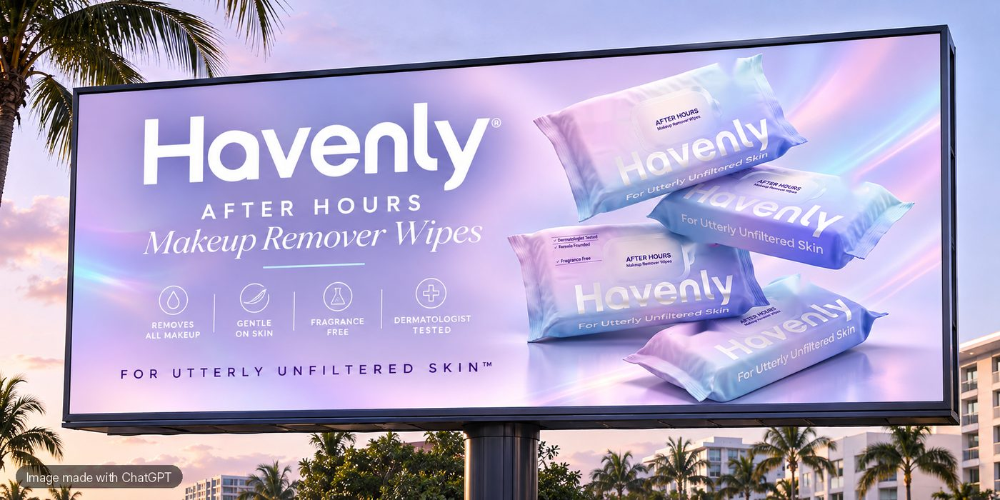

This week I typed 1 word into ChatGPT: **/billboard**. Then I uploaded a photo of my Havenly makeup remover wipes. A few seconds later, I had a billboard that looked like it belonged on a Miami highway. No designer. No brief. Just a slash and a photo.

So here is the short answer. **ChatGPT codes are short words, often starting with a slash, that you type to tell ChatGPT exactly what kind of answer you want.** "/BILLBOARD" means "turn this into a billboard ad." "/SOP" means "turn this into step by step instructions." Most of them are not secret settings. They are shorthand that ChatGPT is smart enough to understand.

Below are 30 ChatGPT codes I wrote for running a business, grouped by job, plus the 1 setting that makes them work the same way every time.



*The billboard I made with /billboard and 1 product photo. Image made with ChatGPT.*

## What are ChatGPT codes, really?

Here is the part most viral posts skip. There are 2 kinds of "codes" in ChatGPT.

**1. The real slash menu.** ChatGPT has a built in shortcut. According to [OpenAI's own help page on ChatGPT search](https://help.openai.com/en/articles/9237897-chatgpt-search), you can type "/" in the message box and pick Search from the pop up menu. That's a real feature, made by OpenAI.

**2. Shorthand codes.** Codes like /BILLBOARD, /TLDR or /SOP are not official buttons. Nobody at OpenAI built them. They work because ChatGPT reads your words, recognizes the pattern and gives you its best guess. That's why the same code can give you a slightly different answer each time.

That surprised me. I thought these were hidden commands. They're not. They're just very good shortcuts. And once you know that, you can make them work even better.

| | Real slash menu | Shorthand codes |
|---|---|---|
| Who made it | OpenAI | Creators and users like you |
| How it works | Type "/" and pick a tool | Type the code with your request |
| Same result every time? | Yes | Mostly, if you teach ChatGPT your codes |
| Best for | Search and ChatGPT's own tools | Fast, repeatable business tasks |

## How to use a ChatGPT code

It's simple:

1. Type the code at the start of your message.
2. Add what it's for: your product, topic or draft.
3. Upload a photo or file if the code needs one.
4. Send it, then ask for changes in plain words.

Here's exactly how my billboard prompt looked:

```prompt
/BILLBOARD for my makeup remover wipes. Brand name: Havenly. Colors: lavender, blush and white. Tagline: For Utterly Unfiltered Skin. Put the product photo I uploaded on the right side.
```

Want better results? Be honest about what's true. On my first try, ChatGPT added "Made in the USA" to the packs. That's not a claim I can make, so I removed it. **AI will happily invent product claims, so always check the fine print before you post anything.**

## 30 ChatGPT codes for business

Copy any code below, add your details, and send. I grouped them by the job they do.

### Marketing and content codes

1. **/BILLBOARD** turns a product photo into a billboard style ad.
2. **/CAPTION** writes 3 social captions with different hooks.
3. **/HOOKS** gives you 10 scroll stopping first lines for a video or post.
4. **/CAROUSEL** turns an idea into a 7 slide Instagram carousel, slide by slide.
5. **/REPURPOSE** turns 1 blog post into a LinkedIn post, a carousel and a short video script.
6. **/PRODUCTDESC** writes a product description for your website or Amazon.
7. **/PRESSRELEASE** turns your news into a short press release.
8. **/UGCSCRIPT** writes a 30 second creator script with a hook, a demo and a call to action.

```prompt
/HOOKS for a short video about why I made bigger, thicker makeup remover wipes for Gen Z. Keep each hook under 12 words.
```

### Sales and customer codes

9. **/COLDPITCH** writes a short, friendly first email to a buyer or partner.
10. **/FOLLOWUP** writes a polite nudge for someone who went quiet.
11. **/OBJECTIONS** lists the top 10 reasons a customer might say no, with an answer for each.
12. **/REVIEWREPLY** writes a kind reply to a customer review, good or bad.
13. **/FAQ** writes the 10 questions your customers ask most, with short answers.
14. **/PERSONA** describes your ideal customer: age, problems, goals and where she shops.

### Operations codes

15. **/SOP** turns messy notes into step by step instructions anyone on your team can follow.
16. **/CHECKLIST** turns any task into a checklist you can tick off.
17. **/MEETINGNOTES** turns a messy transcript into decisions, owners and deadlines.
18. **/AGENDA** writes a 30 minute meeting agenda with times for each topic.
19. **/JOBPOST** writes a clear job post for a freelancer, with tasks and pay.
20. **/BRIEF** writes a 1 page brief for a designer, developer or manufacturer.

```prompt
/SOP from these notes. Make it 8 steps or fewer, 6th grade reading level, and add a "common mistakes" list at the end: [paste your notes]
```

### Strategy and money codes

21. **/SWOT** lists your strengths, weaknesses, opportunities and threats in a simple table.
22. **/PRICING** suggests 3 price options and explains who each one is for.
23. **/LAUNCHPLAN** builds a 30 day launch plan, week by week.
24. **/COMPETITORS** compares you to your top competitors in a table. Turn on search for this one.
25. **/NEGOTIATE** helps you prepare for a supplier or partner call: your ask, their likely pushback and your best reply.
26. **/DECISION** lists the pros, cons and risks of a choice, then asks you 3 questions before it recommends anything.

### Writing and editing codes

27. **/MYVOICE** rewrites a draft so it sounds like you, not a robot.
28. **/SHORTEN** cuts any text in half without losing the point.
29. **/6THGRADE** rewrites anything so it's easy for anyone to read.
30. **/CRITIC** gives honest, specific feedback on your work, with the 3 biggest fixes first.

## The setting that makes ChatGPT follow your codes every time

Since most codes are shorthand, ChatGPT is guessing what you mean. You can stop the guessing in 2 minutes.

Put your favorite codes in your **custom instructions**, the standing rules ChatGPT reads before every chat. Then /SOP means the same thing on Monday as it does on Friday. If you have never set them up, here is my guide to [ChatGPT custom instructions](https://lisahaven.co/blog/chatgpt-custom-instructions/), with a template.

Paste this into your custom instructions and change it to fit your business:

```prompt
MY CODES
When I start a message with one of these codes, follow its meaning:
/CAPTION = 3 social captions, each with a different hook, under 150 words.
/SOP = step by step instructions, 8 steps or fewer, 6th grade reading level.
/FOLLOWUP = a short, warm follow up message that ends with 1 clear question.
/CRITIC = honest feedback, the 3 biggest fixes first, no compliments.
/MYVOICE = rewrite in my voice: direct, warm, short sentences, no em dashes.
If I use a code that is not on this list, tell me what you think it means before you answer.
```

That last line is my favorite. It stops ChatGPT from quietly guessing wrong.

Free ChatGPT accounts get up to 1,500 characters for custom instructions, so pick your top 5 to 10 codes. You can keep the rest in a note and paste them in when you need them.

## 3 mistakes that make ChatGPT codes fail

**1. Code with no details.** "/CAPTION" alone gives you a generic caption. "/CAPTION for my new lavender wipes, for Gen Z, playful" gives you something you can post.

**2. Trusting every claim.** Image codes and ad codes love to add badges, numbers and promises. Read every word before it goes public.

**3. Thinking codes are magic.** They're shortcuts, not secrets. A clear request still beats a clever code. For more on that, read [how to ask ChatGPT a question and get a great answer](https://lisahaven.co/blog/how-to-ask-chatgpt-better-questions/).

## Tools I use for this

*Some links in this post may be affiliate links, which means I may earn a small commission at no extra cost to you. I only share tools I really use.*

- **[ChatGPT](https://chatgpt.com):** where I use these codes every day, including for images like my Havenly billboard.
- **[Claude](https://claude.ai):** my go to for long writing and planning. The same codes work there too.
- **[Notion](https://www.notion.com):** where I keep my full list of codes, so I can copy any of them in seconds.

## Your next step

Pick 5 codes from this list tonight. Add them to your custom instructions, then try 1 on a real task tomorrow morning. You'll feel the difference by lunch.

**Want prompts that are already written for you?** [LUMAPROMPT.AI](https://www.lumaprompt.ai/?ref=blog-chatgpt-codes) is my library of prompts written by real human experts, for your business, your home and your family. They work in ChatGPT and Claude.

## FAQ

**Are ChatGPT codes real?**
Some are. ChatGPT has a real "/" menu, and OpenAI's help page shows you can type "/" to pick Search. Most viral codes, like /TLDR or /BILLBOARD, are shorthand that ChatGPT understands, not official features.

**Do ChatGPT codes work on the free plan?**
Yes. Shorthand codes are just words, so they work on any plan. Some tools behind them, like making images, may have limits on the free plan.

**How do I make ChatGPT remember my codes?**
Add them to your custom instructions with a short meaning for each one. ChatGPT reads those rules before every chat, so your codes mean the same thing every time.

## Before you go

Quick poll for the comments: **which code are you trying first?** Reply with the number, from 1 to 30. And if you have a code of your own that saves you time, share it. I read every comment.

## Keep reading

- [ChatGPT Custom Instructions: The Setup That Saves Me Hours](/blog/chatgpt-custom-instructions/)
- [How to Ask ChatGPT a Question (and Get a Great Answer)](/blog/how-to-ask-chatgpt-better-questions/)
- [AI Tools for Entrepreneurs: The 9 I Actually Use](/blog/ai-tools-for-entrepreneurs/)

> "Small shortcuts, used every day, add up to big freedom."
