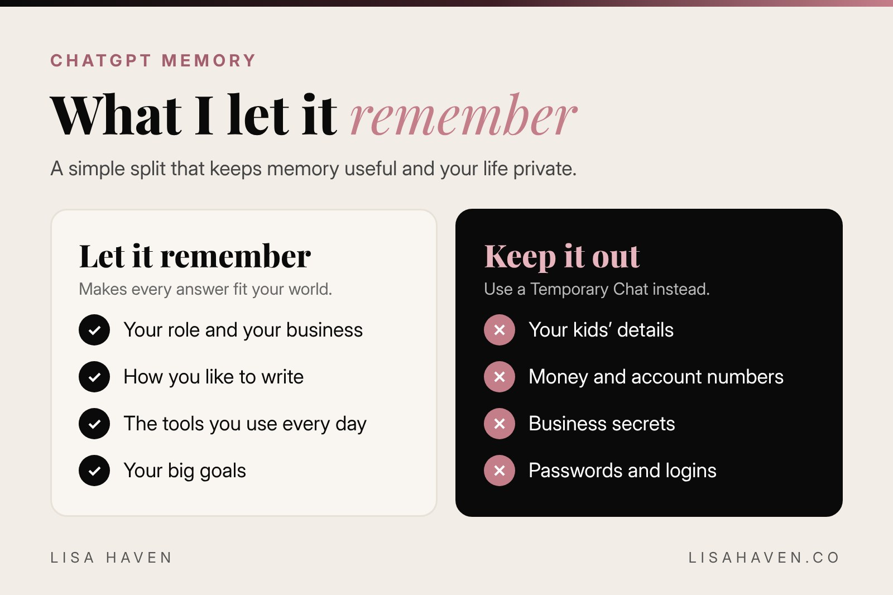

A few weeks ago I tried a prompt I saw online. I asked ChatGPT to describe me, using only what it had learned from our chats.

It described me to a T. My drive, my habits, how I make decisions, even the places where I get in my own way. Honestly, it was a little alarming. Then it kept going. It gave me real steps to work on my weak spots, and I keep coming back to them.

That is the power of **ChatGPT memory: the feature that lets ChatGPT remember details about you from 1 chat to the next**, so you do not have to start from zero every time. I leave mine on almost all the time. I run 3 companies, I am a mom of 3, and I forget things. I need it to remember for me.

But I am also very clear about what it does not get to keep. Here is exactly how ChatGPT memory works, how I use it, and the rules I follow to stay private.

## What is ChatGPT memory?

Think of ChatGPT memory as a notebook ChatGPT keeps about you. Every time you chat, it can look at that notebook and use what it learned to give you a better answer.

In June 2026, OpenAI rebuilt the system. According to the [OpenAI Help Center](https://help.openai.com/en/articles/8590148-memory-faq), memory now pulls useful context from your chats, files and connected apps on its own, then keeps it fresh in the background. It started rolling out to Plus and Pro users in the United States first, with more plans and countries after that.

There are 2 kinds of memory to know:

- **Things you ask it to remember.** You say "remember that I write in short sentences," and it saves that.
- **Things it picks up on its own.** It learns from your past chats over time, like the name of your business or the tools you use.

You can also see a **memory summary**, a page that shows what ChatGPT has pieced together about you. You can read it, correct it and add to it.

Here is the surprising part. OpenAI [says](https://openai.com/index/chatgpt-memory-dreaming/) the new system remembers facts about users correctly 82.8% of the time, up from 41.5% in 2024. That is about twice as good. It is a big reason the "describe me" prompt hit so hard.

## How to turn ChatGPT memory on or off

It takes about 1 minute.

1. Open ChatGPT and click your profile picture.
2. Go to **Settings**, then **Personalization**, then **Memory**.
3. Turn memory on or off.
4. Open your **memory summary** to see what it knows.

The exact names can look a little different depending on your plan, but you will always find memory under Personalization.

Want 1 chat that does not use or create any memories? Start a **Temporary Chat**. OpenAI's help page says Temporary Chats do not use your existing memories and do not make new ones. That is my go to for anything private.

## The prompt that shows what ChatGPT really knows about you

This is my version of the prompt that surprised me. Copy it, paste it into a normal chat with memory on, and read the answer slowly.

```prompt
Using only what you have learned about me from our past chats, describe me in detail.

1. Who I am: my work, my goals and what drives me.
2. How I think and make decisions.
3. My 3 biggest strengths, with an example of each.
4. My 3 biggest weak spots, said kindly but honestly.
5. A simple 30 day plan to work on those weak spots, with 1 small step per week.

Do not guess. If you are not sure about something, say so. Do not flatter me.
```

2 lines in that prompt do the heavy lifting. "Do not guess" keeps it honest. "Do not flatter me" stops it from telling you only what you want to hear.

When I ran it, the weak spots were the part I needed most. The plan gave me small steps I could actually do between school runs and meetings. That is the kind of help that makes you better, not just busier.

**One tip:** if anything in the answer is wrong, tell it. Say "that is not true anymore, please update it." Your memory gets more useful every time you correct it.

## What I let ChatGPT remember (and what I never share)

Memory is only as smart as what you feed it. Here is my simple split.



**What I let it remember:**

- My role and my 3 companies, so every answer fits my world.
- How I like to write: short sentences, everyday words, no fluff.
- The tools I use every day.
- My big goals, so it can keep me on track.

**What I never let it keep:**

- **My kids' details.** No names with schools, no schedules, no photos.
- **Money.** No account numbers, balances or card details. Ever.
- **Business secrets.** Unreleased plans, private deals and anything under an agreement.
- **Passwords and logins.** These never go into any AI chat.

When I need help with something private, I do 1 of 2 things. I use a Temporary Chat. Or, in a normal chat, I say it plainly: **"Do not add this to memory."**

## How to delete a ChatGPT memory (for real)

This is the part most people get wrong.

You can ask ChatGPT to forget something at any time. Just say "forget that I told you about X." You can also delete memories from your memory summary in settings.

But here is the catch. OpenAI's help page explains that to fully delete something, you have to remove it from every place it shows up. That means the saved memory, the chat where you shared it, archived chats and any files or connected apps that hold it. Deleting a chat alone does not always remove a memory, and deleting a memory alone does not erase the old chat.

OpenAI also says it may keep a log of deleted saved memories for up to 30 days for safety and debugging. So the best rule is simple: **if you would not want it saved, do not type it in a normal chat.**

## ChatGPT memory vs custom instructions

People mix these 2 up all the time, so here is the quick version.

| | Custom instructions | Memory |
|---|---|---|
| Who writes it | You, on purpose | ChatGPT, from your chats |
| What it holds | Rules for how to answer you | Facts about you and your life |
| Changes when | You edit it | It updates as you chat |
| Best for | Tone, format and hard rules | Your work, tools and goals |

I use both. Custom instructions tell ChatGPT how to treat me. Memory tells it who I am. If you have not set up your rules yet, start with my guide to [ChatGPT custom instructions](/blog/chatgpt-custom-instructions/), then turn memory on.

You can also see where an answer came from. Tap the small book icon under a response, and ChatGPT shows the sources it used, like your custom instructions, past chats or memories.

## 3 ways I use ChatGPT memory to run 3 companies

**1. It keeps my brands straight.** VIXA, Havenly and LUMAPROMPT.AI each have their own voice and customer. Because ChatGPT remembers all 3, I can say "write this for VIXA" and it already knows who she is.

**2. It remembers what I forget.** I am in and out of chats all day. Memory picks up where I left off, so I do not re-explain my week every time I sit back down.

**3. It helps me grow.** Like the "describe me" prompt, I check in every month or so. I ask what it has noticed and where I can do better. It is like a coach that has read every note.

Want better answers inside each chat too? Read my guide on [how to ask ChatGPT a question and get a great answer](/blog/how-to-ask-chatgpt-better-questions/). And if you use more than 1 AI, my [Claude vs ChatGPT](/blog/claude-vs-chatgpt/) breakdown shows which one I use for what.

## Tools I use for this

*Some links in this post may be affiliate links, which means I may earn a small commission at no extra cost to you. I only share tools I really use.*

- **[ChatGPT](https://chatgpt.com):** where my memory lives. I check my memory summary about once a month.
- **[Claude](https://claude.ai):** my go to for long writing and planning. It has its own memory settings, so the same privacy rules apply there.
- **[Notion](https://www.notion.com):** where I keep the private things I never put into AI, plus a master copy of my prompts.

## Your next step

Tonight, take 5 minutes. Open your memory summary and read what ChatGPT knows about you. Delete anything you would not want saved. Then run the "describe me" prompt above and pick 1 weak spot to work on this week.

**Want prompts written for the way women think?** [LUMAPROMPT.AI](https://www.lumaprompt.ai/?ref=blog-chatgpt-memory) is my library of prompts written by real human experts, for your business, your home and your family. They work in ChatGPT and Claude.

## FAQ

**Is ChatGPT memory on by default?**
For many accounts, yes. Check Settings, then Personalization, then Memory to see your setting. You can turn it off at any time.

**Can I use ChatGPT without memory?**
Yes. Start a Temporary Chat. It does not use your existing memories and does not create new ones. You can also turn memory off in settings.

**How do I see what ChatGPT remembers about me?**
Open your memory summary under Settings, then Personalization. You can also just ask in a chat: "What do you remember about me?"

## Before you go

Quick poll for the comments: **is your ChatGPT memory on or off?** Reply A for "on, always," B for "off, I like a clean slate," or C for "I did not know it existed." And if you try the "describe me" prompt, tell me the 1 thing that surprised you most. I read every comment.

## Keep reading

- [ChatGPT Custom Instructions: The Setup That Saves Me Hours](/blog/chatgpt-custom-instructions/)
- [30 ChatGPT Codes for Business (Copy and Paste)](/blog/chatgpt-codes/)
- [How to Remove Your Address From the Internet With AI](/blog/remove-your-address-from-the-internet/)
- [How to Ask ChatGPT a Question (and Get a Great Answer)](/blog/how-to-ask-chatgpt-better-questions/)

> "The more honestly you know yourself, the faster you grow."
