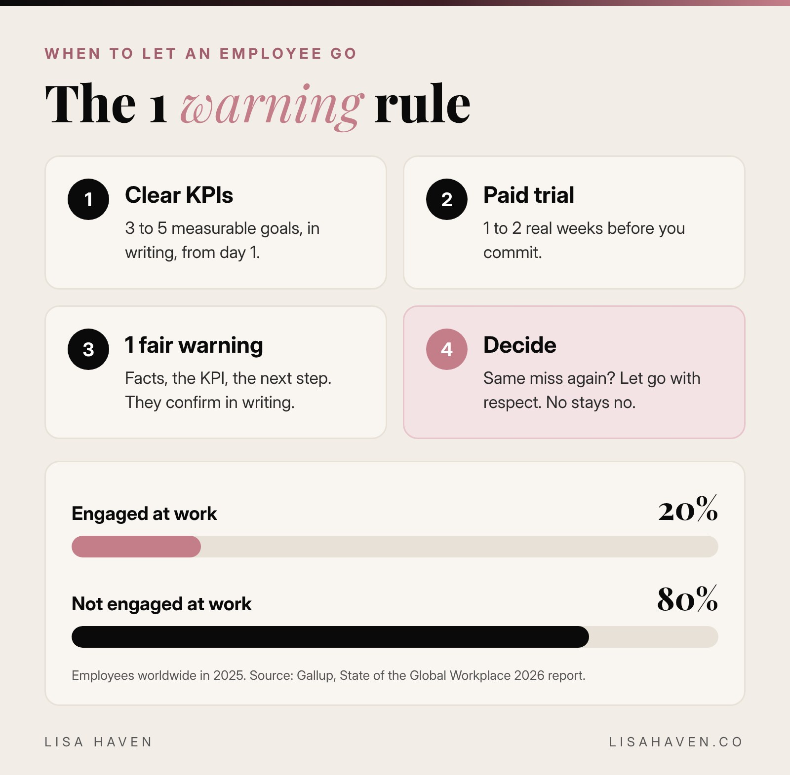

This week I let someone on my team go. I had given 1 clear warning about a core part of the job. A few days later, the same thing happened again. The apologies came after that. My answer stayed the same.

So here is when to let an employee go, in short: **when you set clear expectations, gave 1 fair warning in writing, and the same problem happened again.** That is the moment. Not the third time. Not the fifth. The second miss after a fair warning tells you everything you need to know.

I know that sounds tough. I am kind, I pay bonuses, and I want my team to win. But I run my companies with 1 simple belief: the success of the company comes first, because if it does not succeed, nobody wins. Here is the exact rule I use, how I make it fair, and how AI helps me run it.

## Why firing is never personal

When you are building something from scratch, every person on your team carries a piece of the weight. If 1 piece is not carried, you carry it. Or worse, nobody does, and the business slows down.

That is why letting someone go is a business decision, not a personal attack. I can like someone and still decide they are not the right fit for where my company is going.

Here is a truth every founder learns: **nobody will ever care about your company the way you do.** That is normal. It is your vision. But you can expect the people you pay to care about the job they agreed to do. That is the bar. Not your level of passion. Just the job, done well, every day.

## The first time is a mistake. The second is a choice.

There is a line I have lived by for years:

*"Giving someone a second chance is like giving them an extra bullet because they missed you the first time."*

It is a strong line, and I mean it.

Here is how I see it. **The first time is a mistake. The second time is a choice.**

Life happens. People get sick, kids get sick, flights get delayed, wires get crossed. People mess up. I get it, and I mess up too. That is exactly why the first miss gets grace: a clear, kind, written warning, so we both know the rule.

But once you know the rule, the second miss is never an accident. We are adults. You heard it. You agreed to it. If it happens again, you chose something else over the commitment you made. And when someone shows you what they choose, believe them.

That is why **my 1 fair warning is the second chance.** There is no third. A third and fourth chance does not fix the problem. It teaches people your rules are optional.

## This goes for people, not just business

I live by this in every part of my life: relationships, friendships, business. A company is really just people. The culture you build is made of who you let in and what you let slide.

Think about it. A friend who cancels last minute once, then apologizes and makes it right? That is a mistake. A friend who keeps doing it after you told her how it made you feel? That is a choice. The same is true for a partner who keeps breaking the same promise.

You do not need to be cold about it. You can forgive someone and still decide they do not get a front row seat in your life anymore. Protecting your peace and protecting your company come from the same place: knowing your worth and holding your line.

I am not alone in thinking this way. The Society for Human Resource Management, the largest human resources group in the world, shared a workplace therapist's warning that [second chances for red flag behavior](https://www.shrm.org/topics-tools/news/managing-smart/matter-trust-giving-workers-second-chances) invite the same behavior again. The same article lists lying and stealing as deal breakers on their own. For everything else, 1 warning is fair.

## When to let an employee go: the 4 step rule

The best way to handle a hard goodbye is to make it rare. Steps 1 and 2 are how you avoid most of them. Steps 3 and 4 are how you handle the rest, fairly.



### Step 1: Prevent it with clear KPIs from day 1

KPI means key performance indicator. It is a simple, measurable goal that shows whether someone is doing the job. "Be helpful" is not a KPI. "Reply to every creator within 15 minutes during work hours" is.

You cannot fire someone fairly for missing a goal they never knew about. So I write the KPIs down before anyone starts, and I put them in the contract or the offer. If it matters to the business, it goes in writing.

Ask yourself: if someone read this list, would they know exactly what a great week looks like? If not, fix the list before you judge the person.

### Step 2: Prevent it with a paid trial

I almost never hire anyone straight into a long role. I start with a short paid trial, usually 1 to 2 weeks, with the KPIs from Step 1.

A trial is my favorite way to avoid a bad hire. It shows you how someone works when it counts. Do they show up on time? Do they follow up without being reminded? Do they bring ideas, or wait to be told? You learn more in 1 real week than in 5 interviews.

I wrote about how I set up my team before launch in [how to build a UGC creator program before launch](https://lisahaven.co/blog/how-to-build-ugc-creator-program-before-launch/). The same idea applies to every hire: test first, commit later.

### Step 3: Give 1 fair warning, in writing

When a KPI is missed, I do not stay quiet and let it build up. I name it right away, in writing. A good warning has 4 parts:

1. **What happened.** The facts, with the time and day. No feelings, no labels.
2. **What I expect.** The exact KPI, written again so there is no confusion.
3. **What happens next.** Clearly say this is the 1 warning, and that a repeat means the role ends.
4. **A yes or no.** Ask them to confirm in writing that they understand and agree.

That last part matters. Once someone writes "yes, I understand," there are no surprises later. Everyone is on the same page, and you both know the rules.

### Step 4: If it happens again, decide and move on

If the same problem happens again, make the decision. Quickly and calmly.

This is where a lot of founders get stuck. The person apologizes. They promise it will never happen again. They ask for 1 more chance. And because you are a good person, you want to say yes.

Here is what I have learned: **people show you what they want through what they do, not what they say.** The time to prove it was after the warning. If the answer is no, it stays no.

Then do it with respect. Follow the notice terms in your contract. Pay everything you owe, on time. Thank them for their work. You can be firm and still be classy.

## Is it a skill problem or a care problem?

Before you use the rule, ask 1 honest question: is this person missing the mark because they cannot do it, or because they will not?

| Skill problem | Care problem |
|---|---|
| They try hard but do not know how | They know how but do not do it |
| Gets better with training | Gets better for a week, then slips |
| Asks questions and owns mistakes | Makes excuses or goes quiet |
| Worth coaching | Use the 1 warning rule |

A skill problem is often on you as the leader. Maybe you never trained them. Maybe the tools were bad. Coach those people. They can become your best team members.

A care problem is different. You cannot train someone to care. If they knew the rule, agreed to it in writing and still did not do it, that is your answer.

## The surprising cost of keeping the wrong person

Here is a number that stopped me. Gallup's latest [State of the Global Workplace report](https://www.gallup.com/workplace/349484/state-of-the-global-workplace.aspx) found that only **20% of employees worldwide were engaged at work in 2025**, the lowest level since 2020. Gallup estimates low engagement costs the world economy about $10 trillion in lost productivity.

Think about what that means for a small business. Most people you hire will not be fully engaged. So when you find someone who truly is, protect them, pay them well and grow them. And when someone shows you they are not, do not spend months hoping they will change.

Keeping the wrong person has a hidden cost too. Your best people watch how you handle it. When you let missed KPIs slide, you tell the whole team the bar is lower than you said. Your culture is not what you write on a wall. It is what you allow.

## How I use AI to make this fair

I run 3 companies as a mother of 3, so I cannot afford messy, emotional team decisions. AI helps me keep them clear and fair.

- **Writing the KPIs.** I ask Claude to turn a role into 5 measurable KPIs, so nothing is vague.
- **Tracking the work.** I keep tasks and deadlines on Monday.com, so I can see what got done instead of guessing.
- **Writing the warning.** When something goes wrong, I can be very direct, so AI helps me write a warning that is calm, specific and fair, with no extra emotion.
- **Doing more with fewer people.** AI tools and a custom bot handle a lot of the daily work, so every hire I make has to be truly great.

I shared the full system in [how to manage UGC creators with AI](https://lisahaven.co/blog/how-to-manage-ugc-creators-with-ai/).

Here is the exact prompt I use to write a fair warning. Copy it into ChatGPT or Claude:

```prompt
You are my calm, professional human resources advisor.
Help me write 1 fair written warning to a team member.
What happened (facts only, with dates): [what happened]
The KPI they agreed to: [the exact expectation]
What happens if it happens again: [the consequence]
Write it in short, clear sentences. Firm but respectful.
No blame, no emotion, no long paragraphs.
End by asking them to confirm in writing that they understand.
```

## Tools I use to manage my team

*Some links below may be affiliate links, which means I may earn a small commission at no extra cost to you. I only share tools I really use.*

- **[Claude](https://claude.ai):** I use it to write KPIs, warnings and team messages that are clear and fair.
- **[Monday.com](https://monday.com):** where my team's tasks and deadlines live, so performance is easy to see.
- **[Upwork](https://www.upwork.com):** where I find freelancers and run short paid trials before committing.
- **[Slack](https://slack.com):** where my team talks, so every expectation is written down, not just said.

## Your next step

Open your notes today and write the KPIs for every person on your team. Just 3 to 5 per role. If you cannot write them, your team cannot hit them. Then read [how to manage UGC creators with AI](https://lisahaven.co/blog/how-to-manage-ugc-creators-with-ai/?ref=blog-let-employee-go) to see how I run a team with AI doing the heavy lifting.

## FAQ

**How many warnings should you give before firing an employee?**
I give 1 clear warning in writing for the same problem. If it happens again, I let the person go. Serious issues like lying or stealing do not get a warning at all.

**How do you know when to let an employee go?**
When the expectation was clear, you gave a fair warning, and the same problem happened again. If the issue is a lack of skill rather than a lack of care, try coaching first.

**Should you give an employee a second chance?**
Yes, once. The first time is a mistake, so it gets a fair warning. The second time is a choice. A third chance usually teaches people that your rules are optional.

## Before you go

Where do you stand? **1 warning, 2 warnings, or 3 strikes?** Tell me in the comments how many chances you give and why. I read every single one. 🖤

> "Your standards teach people how to show up for you."
