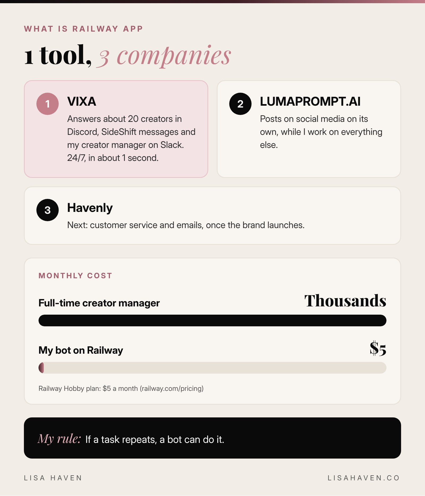
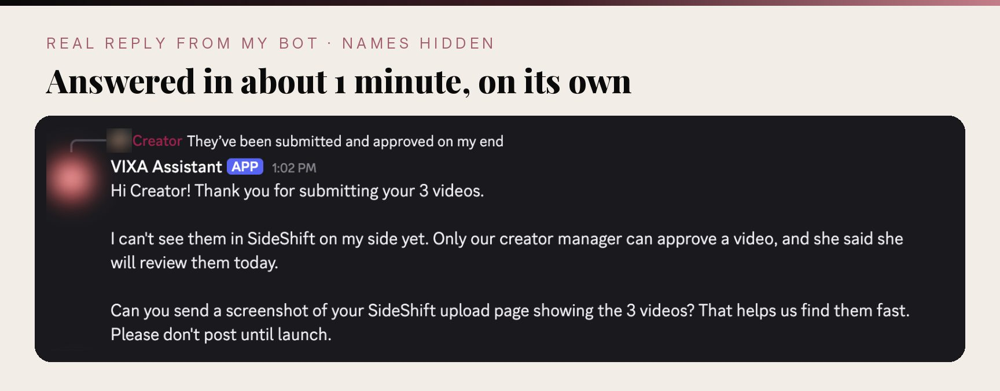

Last week, a creator in my Discord asked a question at 9 PM. I was at home with my daughter. My creator manager was offline. And the answer showed up in 1 second, clear, kind and correct. Nobody on my team typed it. My bot did, running on Railway.

So, what is Railway app? **Railway is a cloud platform that keeps your apps and AI bots running online 24/7, so you do not need your own server or a tech team.** You give it your bot's code, add a few keys, and it stays on day and night. For me, it is the home where my AI helpers live and work.

Besides Claude, it has been the most life-changing tool in my business. Here is exactly how I found it, what it runs for my 3 companies, and what it costs.

**Key takeaways:**

- Railway keeps your AI bots running online 24/7 for about $5 a month.
- My bot answers about 20 creators in about 1 second, even after hours.
- You do not need to code. AI can build the bot with you.
- "I don't know how" is no longer a reason. Ask AI, and start.

## How I found Railway (in my hardest week)

I will be honest with you. Building a team is hard.

I had a full-time creator manager for VIXA, my dating clarity app. It did not work out. Then I let the second one go too. It was not the right fit for either of us, and that is OK. People come and go. I wrote about the rule I use in [when to let an employee go](https://lisahaven.co/blog/when-to-let-an-employee-go/).

But after that decision, I was stuck in the middle. VIXA's success is the core of everything I am building, and I had about 20 creators who needed answers every day. I am a mother of 3. I run 3 companies. I could not sit in Discord all day.

So I did what I always do. I asked AI: "Where can I find a system that answers for me, connects everything and automates this whole process, without me having to hire somebody?"

The answer was Railway.

Here is what I have learned: nowadays there is a tool for everything, and usually 5 or 6 of them. I also looked at n8n, a popular automation tool. But it would have checked for new messages every 15 minutes, and I wanted my creators answered instantly. Railway runs my own bot all day, it was easier, and it was much cheaper. Honestly, it was a no-brainer.

Finding a new creator manager is a long process. You write the job post, interview, test people, and sometimes start over when it does not work out. Managing a lot of creators at once can be extremely overwhelming. Before, I would have had to rush that search and take over the whole job myself in the meantime.

Now I do not have to rush. The bot runs the day to day while I take my time to find the right person. And today, I am so happy things happened the way they did. God really does make a way.

## What is Railway app, in plain words?

If the word "cloud platform" makes your eyes glaze over, think of it like this:

- **Your bot is the employee.** It is the code that answers questions, writes messages or posts content.
- **Railway is the office.** It is where that employee sits and works, 24 hours a day, 7 days a week.
- **The keys are the badge.** You paste in a few passwords for apps like Discord or Slack, so your bot can get in the door.

Without a place like Railway, your bot only works while your laptop is open. With Railway, it works while you sleep, while you are at the gym, and while you are making dinner.

Railway started in 2020 in San Francisco, and over 2 million people were using it by January 2026, [according to Sacra](https://sacra.com/c/railway). It was built for developers, but here is my secret: **you do not need to be a developer to use it.** I am not one.

## What Railway runs for my 3 companies

Here is everything Railway does for me right now.



### VIXA: my creator program runs itself

My bot is called VIXA Assistant. It lives on Railway and it:

- **Answers every creator in our Discord group.** About 20 creators, in every channel, in about 1 second.
- **Answers creator messages on SideShift**, the app where our creators apply and sign their contracts.
- **Answers my creator manager on Slack**, so she is never stuck waiting on me.
- **Covers after hours.** A lot of our creators are on the West Coast. When my manager is offline, the bot handles her tasks and keeps everyone moving.
- **Hands me the big stuff.** If it does not know an answer, or it is about pay or contracts, it tags me. I just get a Discord notification.

The best part? I simply uploaded the document that explained how the whole creator operation runs. The bot read it, understood it, and now answers all the repetitive questions. Creators stay in the loop instead of sitting there wondering.

### LUMAPROMPT.AI: the socials post on their own

Railway also runs the social media for [LUMAPROMPT.AI](https://www.lumaprompt.ai), my prompt library for women. Another bot, same Railway account, posting while I work on everything else.

### Havenly: next on the list

Havenly, my makeup remover wipes brand, is still getting set up with our manufacturer. Once it launches, I will automate whatever I can: customer service, emails and more. If it is not Railway, it will be another tool. I am a software junkie, and I will automate anything I can.

I explained how I built my first bot in [how to create an AI agent with Claude](https://lisahaven.co/blog/how-to-create-an-ai-agent-with-claude/). Railway is simply where that kind of agent lives once it is ready.

## The moment it clicked for me

The moment I knew this was different was the first time the bot did the entire job on its own.

A creator asked a question. The bot answered in 1 second. And the answer was fantastic. Better than some of the answers a person on my team would have given.

Here is a real reply from my bot to one of my creators this week. I hid the names to protect their privacy.



That is not a knock on anyone. People are busy. One of my managers was also a mom, and nobody can answer instantly every single time. That is life. But a bot can.

And while it worked, I was able to step away and take care of my child. That is what freedom looks like to me. Not working less. Working on the right things.

## What does Railway cost?

Railway's Hobby plan is $5 a month, with $5 of usage included, and you only pay more if your bot uses more ([Railway pricing](https://railway.com/pricing)). There is also a free 30 day trial with no credit card needed.

Now compare that with what I was paying for a full-time creator manager: **thousands of dollars a month.**

| | Full-time creator manager | My bot on Railway |
|---|---|---|
| Monthly cost | Thousands of dollars | $5 |
| Hours | Set work hours | 24 hours, 7 days a week |
| Reply time | Minutes to hours | About 1 second |
| Bad days | Sometimes | Never |
| Repetitive questions | Gets tired of them | Answers them all, kindly |

I literally told my daughter, "This was God sent."

My setup part took about 2 minutes. I pasted in a few keys, and it was live. Claude did the coding with me. I started last week, and I barely check my Discord now. I just ask Claude how the bot is doing and how everything on Railway is running. If something crashes, we fix it right away.

## Do you still need people?

Yes. I want to be honest here.

I do not want to say I never need a creator manager. I still want 1 great person to oversee everything, welcome new creators and give them a real human touch. Calls, approvals and relationships need a person.

But answering the same questions every time a new creator joins? I do not need a human for that. It is simply not an efficient use of anyone's time. If AI can answer it in 1 second, why not? It is easier, it is faster, and everybody saves time.

Here is how I believe a company should run today: **you do not need 10 employees. You need 1 great employee, and AI doing the repetitive work, with that person overseeing what AI already does well.** That is my 2 cents.

And it is working. Right now, I am the one overseeing what AI does, and my bot is doing the job of about 2 people, 24 hours a day, 7 days a week. It has been so helpful. I am truly happy. This is life-changing, and it is exactly how I plan to grow all 3 of my companies.

And remember, a person makes mistakes too. So does AI. The difference is that my bot learns from a written playbook, I check its work every day with Claude, and it is never in a bad mood. There is no attitude, no disagreement and no drama. Sometimes an employee is just not for you. AI really is for you.

## How AI taught me the tech side

Here is something most people do not know about me. I was born and raised in Brazil, and I came to the United States when I was 13. I did not grow up knowing everything, and I am not a school person. I do not have time to sit in a classroom.

But when a topic interests me, I will sit at my computer for 13 hours and learn it. And today, I learn almost everything from AI.

I rarely ask a person a question anymore. I ask AI. When I started building VIXA, I did not know what a server was. So I asked: "What is a server? Do I need one? What does it actually do? Explain it in simple terms, and show me a picture of how it works."

That is how I learned the whole setup behind my app, step by step. Today you could ask me almost anything about it, and I could answer you. All because of AI. It explains things as many times as you need, in as many ways as you need, and it never gets impatient with you.

I use them all, each for what it does best:

- **Claude** for building, writing and running my businesses.
- **ChatGPT** for everyday questions and ideas.
- **Perplexity** for quick research with sources.
- **Gemini** for translating and breaking down YouTube videos, which is where a lot of my marketing ideas come from.

My day to day life runs on AI.

Honestly? I find AI fascinating. I am obsessed with it. Years ago, I was obsessed with photography when I first picked up a camera. Now it is AI, and I use it to its full potential. There is still so much I do not know, and I am excited to learn all of it. My goal is simple: to become an AI expert within 5 years.

Want to learn any tech topic the way I do? Copy this into any AI:

```prompt
I am not technical, and I want to understand [the topic].
Explain it to me in simple words, like I am 12.
Tell me what it is, what it actually does, and whether I need it.
Give me 1 everyday example, then draw or describe a simple picture of how it works.
Then ask me 1 question to check that I understood.
```

## "But I don't know how" is not a reason anymore

People come to me all the time with brilliant ideas for a business. Then I hear the same words: "But I don't know how."

That honestly blows my mind. It has never been easier to start a company and learn new things than it is today. There are YouTube videos teaching a thousand topics. And just by asking AI, you already have your starting point. That is exactly where you start.

You can ask AI questions like these, about your exact idea:

- What is the TAM for a business in this niche? (TAM means total addressable market: how big the whole market is.)
- How do I market this business?
- Give me 5 different ways to reach $100,000 in sales within 3 months in this niche.
- How do I create a product people keep coming back to? How do I get the highest retention possible?
- How can I pitch this product to a venture capital investor?
- Where can I find a business partner or a co-founder?
- How do I grow my social media for this company?

You do not even need to Google anymore. AI meets you inside your own niche, and you can get as specific about your idea as you want. It is right there for you, any time.

Building a company can be quite the adventure. But the only real way to fail now is to not start at all. AI is here to help you. AI is here to guide you. AI is here for your future. And I am so glad I use it.

Here is a prompt to turn "I don't know how" into a plan:

```prompt
You are my business coach and startup advisor.
My business idea is: [your idea].
My niche and who it is for: [your niche].
Tell me how big the market is, in simple words.
Give me 5 ways to reach my first $100,000 in sales, ranked from easiest to hardest.
Then give me my first 3 steps for this week.
Ask me any questions you need before you answer.
```

## How to set up your first bot on Railway

You do not need to code. You need a clear job and an AI to help you build it. Here is the path I followed:

1. **Pick 1 repetitive job.** Answering the same questions, sending reminders, or posting content.
2. **Write the rules down.** Put how you want it done in a simple document. This becomes the bot's playbook.
3. **Ask Claude or ChatGPT to build the bot with you.** Use the prompt below.
4. **Put the code on GitHub.** It is a free place to store code. Your AI will walk you through it.
5. **Connect GitHub to Railway.** Add your keys, and Railway keeps your bot on 24/7.
6. **Check it every day for the first week.** Fix anything it gets wrong in the playbook.

Here is the prompt to start with. Copy it into Claude or ChatGPT:

```prompt
You are my patient, step by step tech partner. I am not a developer.
I want to build a bot that does this job for my business: [the job].
It should work inside: [Discord, Slack, email or another app].
Here are my rules for how it should answer: [paste your playbook].
Walk me through building it 1 small step at a time.
Use GitHub to store the code and Railway to keep it running 24/7.
After each step, wait for me to say "done" before the next one.
Explain every step in simple words, like I am 12.
```

## Why I would invest in AI software if I could

I have a financial advisor, and I am not giving anyone money advice. But I truly believe AI software is the future. If Railway had a stock, I would call my advisor and tell him to buy it right away.

You cannot, though. Railway is a private company, so you cannot buy its stock today. It [raised $100 million in January 2026](https://briefglance.com/articles/railway-raises-100m-to-build-the-clouds-future-for-ai-developers) to grow.

Here is the surprising part. Research firm Sacra [estimates Railway grew from about $20 million in yearly revenue at the end of 2025 to about $100 million by September 2026](https://sacra.com/c/railway). That is about 5 times bigger in less than a year. That tells me I am not the only one who sees it.

Computers are the future. AI makes life easier. I can work from anywhere. It is like a personal assistant that works 24/7 and never has a bad day. Even when a tool is not for me, I still try it, because that is how I learn.

And honestly? Some people pick sides in politics. My side is AI. If you are against AI, we can still be friendly, but we are not the same. 😂

## Tools I use to automate my businesses

*Some links below may be affiliate links, which means I may earn a small commission at no extra cost to you. I only share tools I really use.*

- **[Railway](https://railway.com):** where my bots live and run 24/7, for $5 a month.
- **[Claude](https://claude.ai):** my right hand. It built my bots with me and checks how they are doing.
- **[GitHub](https://github.com):** where my bot code is stored, free.
- **[Slack](https://slack.com):** where my team talks, and where my bot answers my creator manager.

## Your next step

Pick 1 repetitive job in your business today. Just 1. Write down how you want it done, then paste the prompt above into Claude or ChatGPT and build your first bot this week. If you want to see the full system behind my creator program, read [how to manage UGC creators with AI](https://lisahaven.co/blog/how-to-manage-ugc-creators-with-ai/?ref=blog-railway-app).

## FAQ

**What is Railway app used for?**
Railway is used to keep apps, websites, databases and bots running online 24/7. I use it to run my AI bots for Discord, Slack, SideShift and social media.

**Is Railway free?**
Railway has a free 30 day trial with $5 in credits and no credit card. After that, the Hobby plan is $5 a month, which includes $5 of usage.

**Do I need to know how to code to use Railway?**
No. I am not a developer. I use Claude to write the code with me, store it on GitHub, and Railway keeps it running.

## Before you go

Tell me in the comments: **what is the 1 task you would hand to a bot first?** Answering emails, customer questions, social posts, or something else? I read every single comment. 🖤

> "Build the system once, and let it work while you live."
