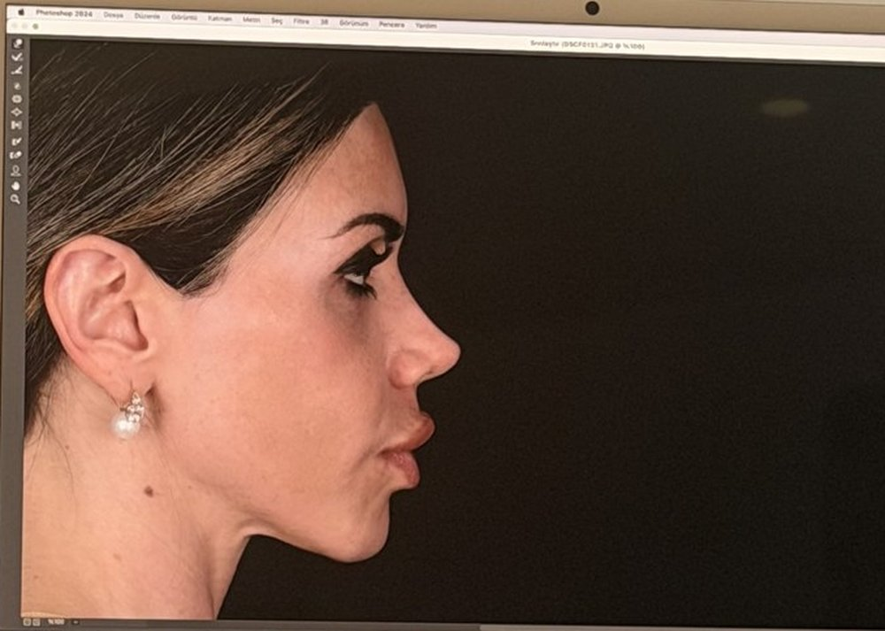
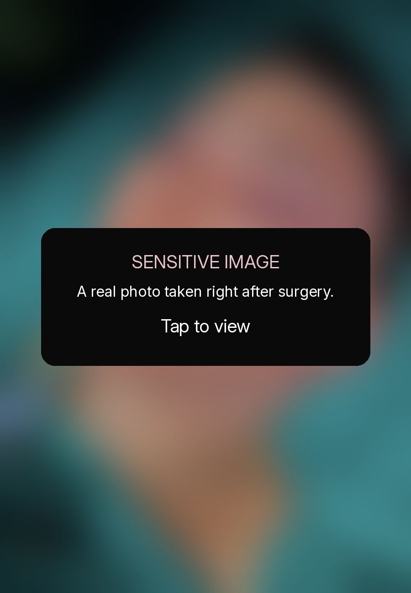
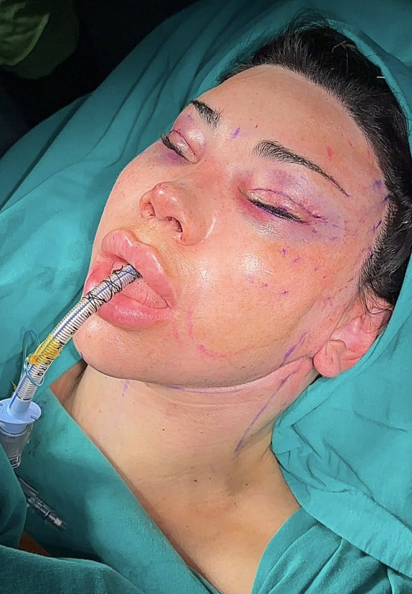
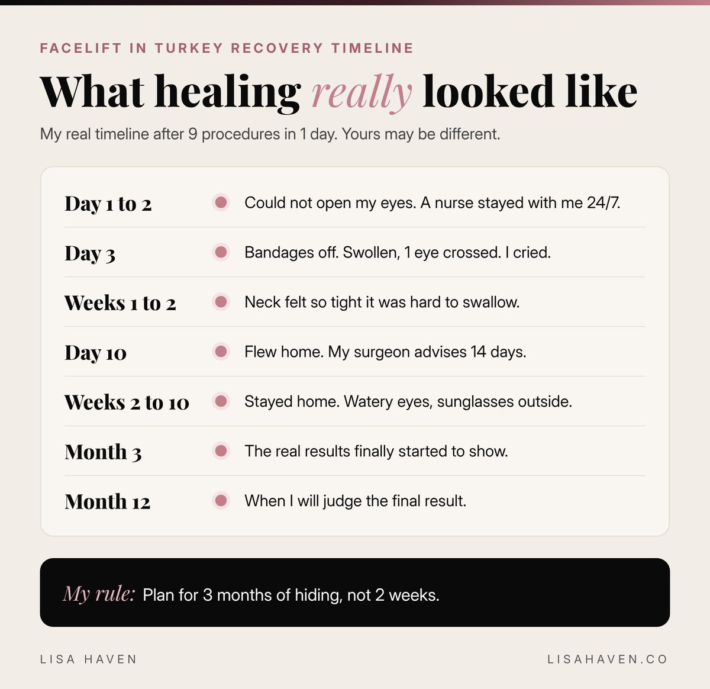
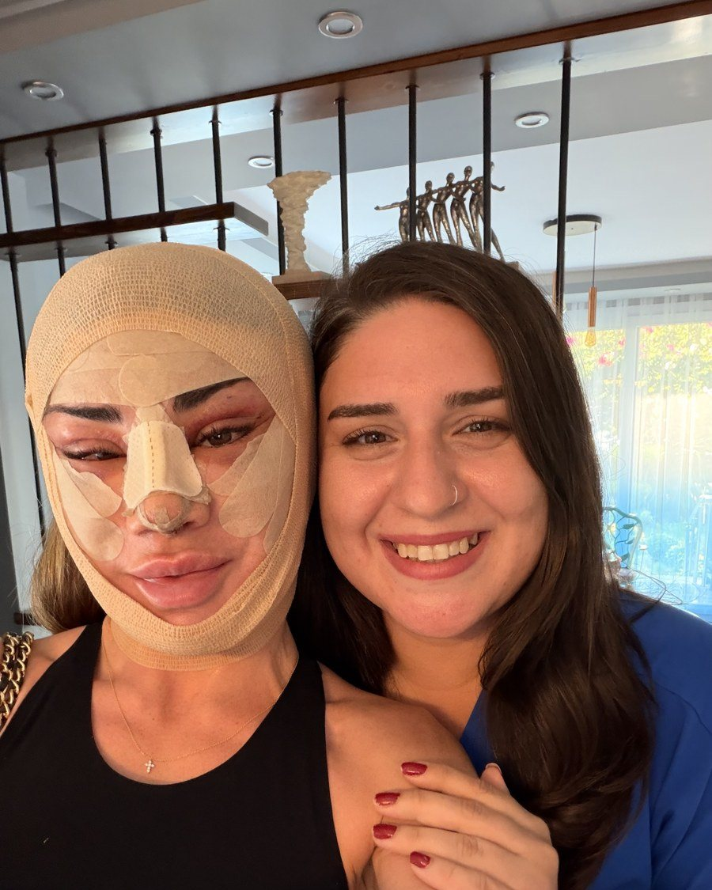
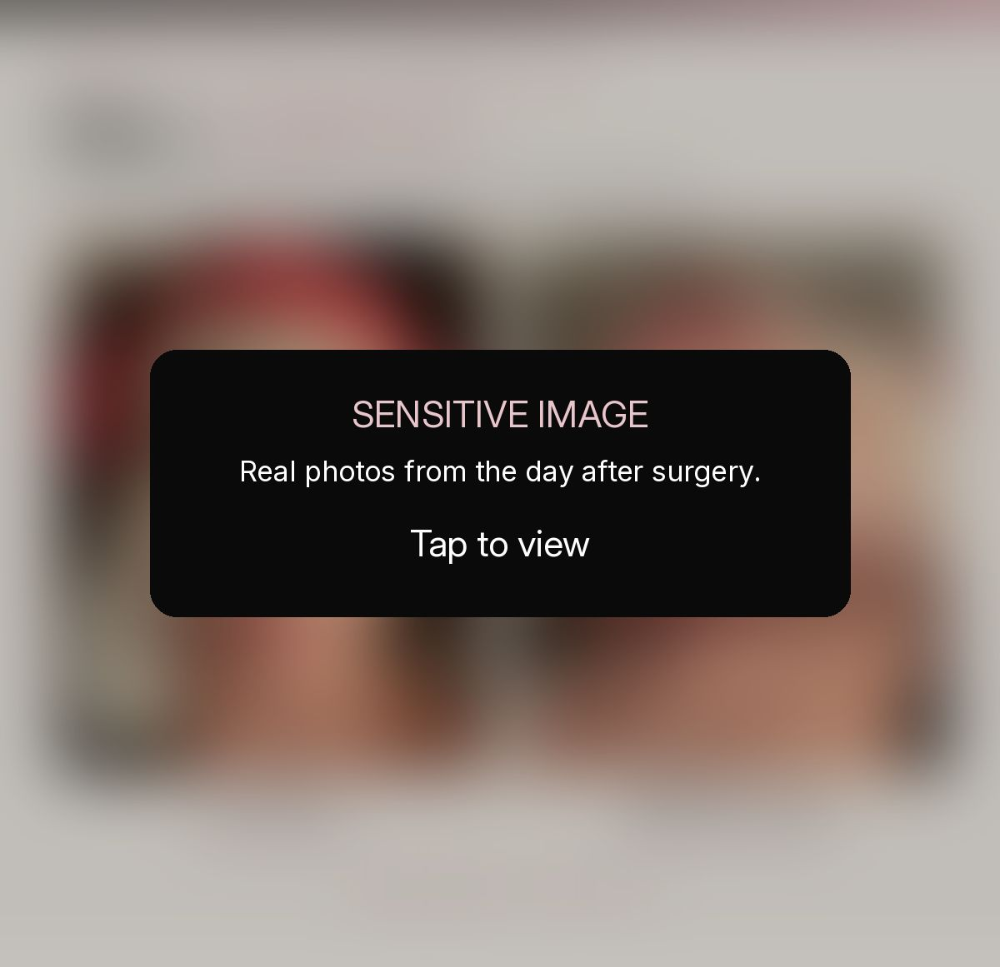
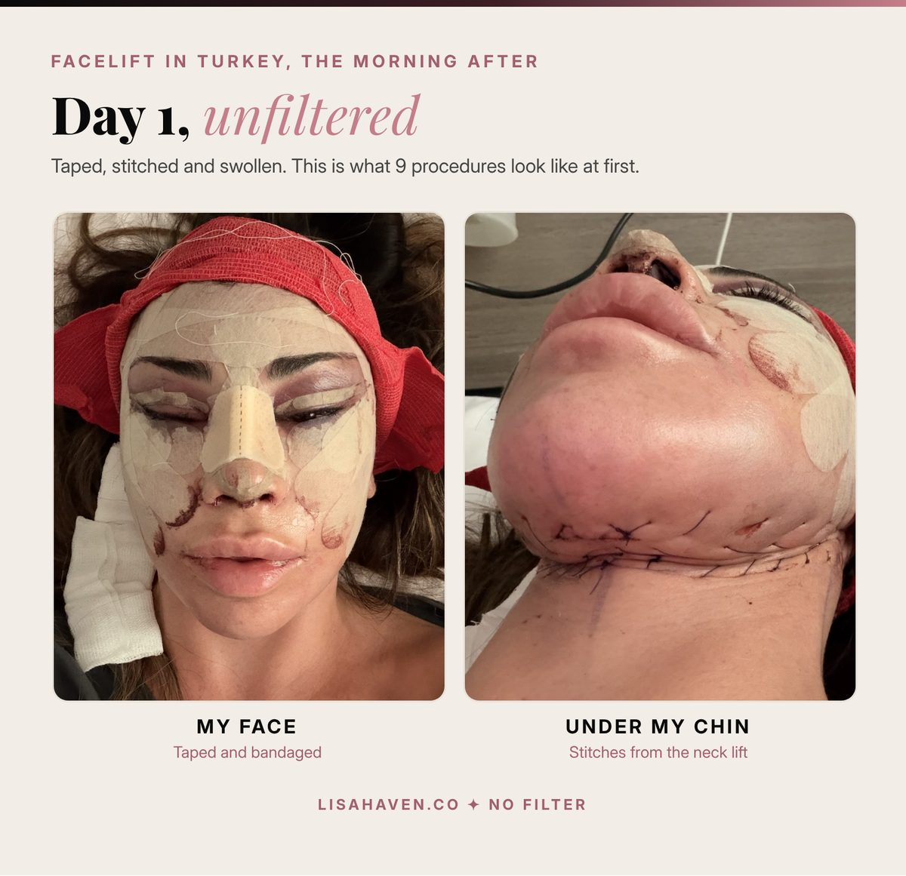
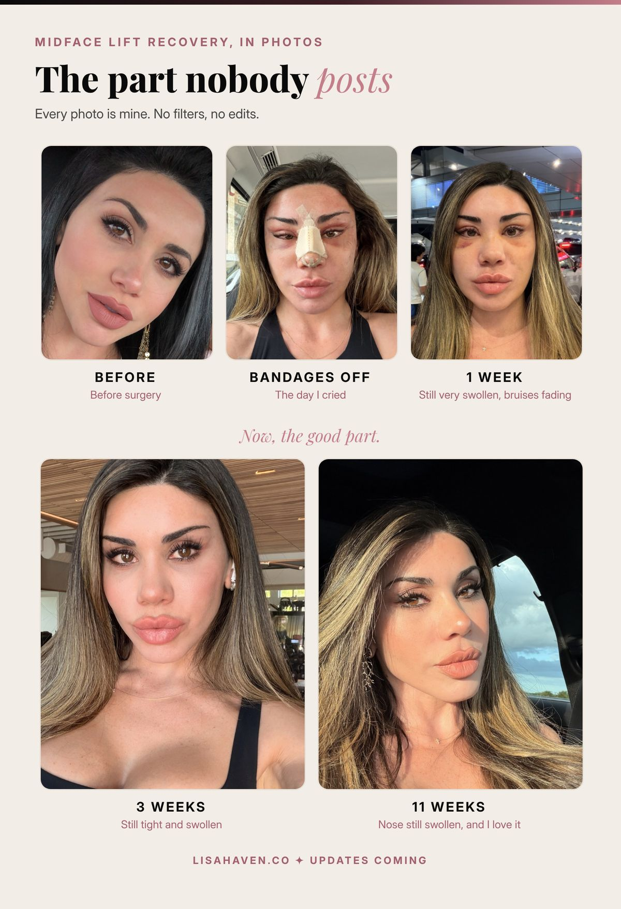
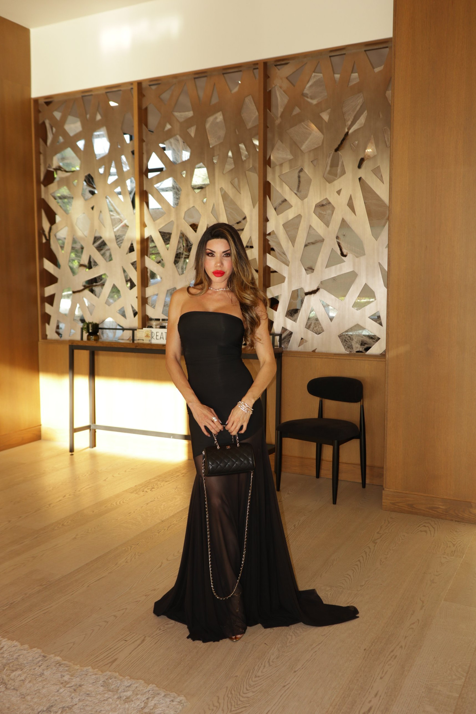

On the third day, the nurse gently unwrapped my bandages. I looked into the mirror, then at my surgeon, and the tears came before I could stop them. The woman looking back at me was so swollen I barely recognized her. 1 eye had drifted inward. In that moment, I was certain my face had been ruined.

He met my eyes, completely calm, and said, "Lisa, this is normal."

This is my honest **facelift in Turkey review**, written for the woman who is quietly researching at midnight, the way I once was. The short answer: I had 9 procedures in a single day, including a deep plane midface lift and neck lift rather than a full facelift, and at 3 months I would rate my results a 9 out of 10. But the recovery was longer, harder and far more emotional than any before and after photo prepared me for. In the pages below, I share every photo, the AI prompt I used to choose my surgeon, my real recovery timeline and the lessons I wish someone had shared with me first.

A quick note before we begin: this post is not sponsored. I paid for my surgery myself, and I receive no discount, perk or commission for telling this story. And every photo you see here is shared exactly as it was taken, with no filter.

## Why I Chose to Do It

I am 41. I am a mother of 3 daughters, I run [3 companies](https://lisahaven.co/blog/from-zero-to-three-companies/), and I am the face of my brands.

For a long time, I quietly avoided the camera. I had never made peace with my nose, and I could see my eyes beginning to soften and droop. I noticed it in every video I filmed and every photo I shared. When your face is part of your business, that kind of insecurity costs you more than confidence. It costs you content, connection and, eventually, growth.

This was my third nose surgery, so I wanted it done right, and done for good. Over the years, I had also spent thousands of dollars on Botox and fillers. There is nothing wrong with either, but I wanted something lasting. I wanted to begin caring for myself now, with intention, rather than chasing small fixes later.

My first consultation was with a plastic surgeon here in the United States. She told me, almost immediately, that I did not need anything. I left frustrated. Perhaps she thought I was too young, and she was entitled to her opinion. But I am the one who sees my reflection every morning. I knew what I wanted to change, and I wanted a surgeon who would truly listen.

So I waited for the right season. My youngest was still a baby, and I wanted her to be at least 1 year old before I traveled. I also needed 2 full weeks away, alone, in another country. Summer became my window, and I finally booked it.

## How I Used AI to Choose My Surgeon

For about 2 years, I studied plastic surgeons on Instagram and saw hundreds of before and after photos. 1 name kept rising to the top: [Dr. Vasfi Çelik](https://www.instagram.com/drvasficelik/), an aesthetic, plastic and reconstructive surgeon in Mersin, Turkey.

What first caught my attention was that other doctors learn from him. When surgeons study your technique, it says something meaningful about your skill.

Still, beautiful photos are not research. From the outside, it is surprisingly hard to know whether a surgeon is board certified, how long they have practiced or whether they have ever been sued. That is where AI became my most valuable research partner.

I chose 3 surgeons I admired and asked ChatGPT to evaluate each one on the things that mattered most to me:

- **Board certification** and genuine medical training
- **Years in practice**, so I was not anyone's first case
- **Teaching**, meaning they train other doctors
- **Lawsuits** or serious complaints
- **Patient testimonials**, both glowing and critical

ChatGPT organized everything into a side by side table with the strengths and concerns of all 3, then helped me narrow my choice. Dr. Vasfi's profile lists memberships in ISAPS (the International Society of Aesthetic Plastic Surgery), ASPS (the American Society of Plastic Surgeons) and TPRECD (the Turkish Society of Plastic, Reconstructive and Aesthetic Surgery).

The final decision, however, came down to 2 things no AI can measure for you.

**The first was responsiveness.** 1 of the 3 clinics took a very long time to reply. Dr. Vasfi's team answered quickly and clearly, every single time. That matters more than most people realize. If something goes wrong after surgery, you need a team that answers.

**The second was trust.** I simply felt safe with him, and that feeling deserves a vote.

On testimonials, I will say this. Some clinics do reward patients for reviews. But if a woman's face were truly botched, no incentive in the world would convince her to praise that surgeon on camera. His patients speak about him with genuine warmth, 1 after another, and that told me a great deal.

> AI did the research. My intuition made the decision.

### Why careful research matters

A close friend of mine also had surgery in Turkey, at a different clinic. A student performed her procedure instead of the surgeon she had paid for, and after her eyelid surgery, she could not fully close her eyes. When she showed me the photos, I was heartbroken for her. I will not name anyone, but her story is very real, and it is the reason I am so passionate about this part.

Please, do your research. Below is a more complete version of the prompt I used. Copy it, fill in the blanks and paste it into ChatGPT or any AI you prefer.

```prompt
I am planning plastic surgery and I am comparing 3 surgeons. Please research each one deeply and be honest, even if the answer is bad news.

Surgeon 1: [NAME, CITY, COUNTRY]
Surgeon 2: [NAME, CITY, COUNTRY]
Surgeon 3: [NAME, CITY, COUNTRY]
Procedures I want: [LIST]

For each surgeon, check the following and give me sources:

TRAINING AND CREDENTIALS
1. Which medical school did they attend? Is it real, accredited and well respected?
2. Where did they do their plastic surgery residency, and did they do any extra fellowship training?
3. Are they board certified in plastic surgery by the right board for their country? Is that board real and recognized?
4. Are they members of respected plastic surgery societies, local or international?
5. Is their medical license active, with no suspensions?

EXPERIENCE
6. How many years have they been a plastic surgeon?
7. How often do they do my exact procedures? Is this their specialty?
8. Do they teach, train other surgeons, speak at conferences or publish research?

SAFETY AND REPUTATION
9. Are there any lawsuits, malpractice cases, complaints or bad news stories about them?
10. Does the surgeon do the whole surgery personally, or do students or assistants operate?
11. Who gives the anesthesia? Is it a certified anesthesiologist?
12. Is the surgery done in an accredited hospital, not a small clinic?
13. Is there 24/7 nursing care after surgery?

RESULTS AND REVIEWS
14. What do real patient reviews and video testimonials say, good and bad? Look beyond their own website.
15. Do they show healed results at 6 to 12 months, not just right after surgery?
16. Do their results look natural and match the look I want?

CARE AND COMMUNICATION
17. How fast and how clearly does their team reply to messages?
18. What happens if I have a problem or emergency after I fly home?
19. What is included in the price: hotel, transport, nurse, follow ups, revisions?
20. What is their policy if I need a revision?

RED FLAGS
21. Watch for prices that seem too cheap, pressure to book fast, too many surgeries done in 1 day, or no clear answers.

Put all 3 surgeons in a side by side table. Give each a score out of 10, list every red flag you found, and tell me which one fits me best and why. Then give me 10 questions to ask in my consultation.
```

Think of AI as a research partner, not a doctor. Let it surface the facts and the red flags, then confirm the important details yourself and during your consultation. If you would like better answers from any AI, my guide on [how to ask ChatGPT better questions](https://lisahaven.co/blog/how-to-ask-chatgpt-better-questions/) will help.

## The Journey: A Gift to Myself

I wanted this for 2 years, so I decided to treat the entire trip as a gift to myself.

I flew first class to Istanbul, then took a short flight south to Mersin. The clinic's team met me at the airport, took care of every detail and drove me to a lovely 4 star hotel.

What struck me first was the people. Everyone was kind, and not in a rehearsed way. They genuinely cared, and you could feel how much they loved their work. That warmth settled my nerves and confirmed that I was in the right hands.

The preparation had been just as smooth. I completed my blood work at home before leaving. We had a FaceTime consultation where I shared every concern, and I sent videos in good lighting so he could study my face in detail.

When I arrived, Dr. Vasfi welcomed me with roses, a gesture he offers every patient. Then we moved through my final tests. He also pulled up my profile on his screen and showed me a preview of how my nose could look after surgery. Seeing it there, on the screen, made everything feel real.



In person, he studied my face carefully and said, "Lisa, I think you need a little more here, and perhaps some fat grafting here and here." He also pointed out a little loose skin on my neck, left over from losing weight, and explained how the neck lift would tighten it.

I settled into his chair and told him, "Doctor, I am your canvas. Do whatever you think is best. Just make me look 20 again." Then, with a smile, I added, "Actually, could you simply reverse my age?"

We both burst out laughing. In that moment, I knew this experience would feel joyful rather than frightening.

## What I Had Done: 9 Procedures in 1 Day

My surgery took place on August 6, 2026, and lasted about 8 hours under general anesthesia. Here is what my surgical report lists, translated into plain language:

1. **Revision rhinoplasty (the shape of my nose).** He rebuilt the structure using donor rib cartilage from a tissue bank, meaning cartilage donated by someone who has passed away. He straightened my nose and corrected my uneven nostrils.
2. **A breathing correction.** He straightened my septum and opened my airways, so I now breathe more easily.
3. **Endoscopic deep plane midface lift.** To be precise, this is what I had instead of a full facelift. It lifts the cheeks from deep beneath the skin, through very small incisions.
4. **Endoscopic brow and temple lift.** This created the softly lifted cat eye I had admired for 2 years, and my brows have never looked better.
5. **Upper eyelid lift**, also known as upper blepharoplasty.
6. **Lower eyelid lift**, also known as lower blepharoplasty.
7. **Deep plane neck lift.** This tightens the neck from the deeper muscle layer.
8. **Under chin tightening**, also known as a submentoplasty, performed with the neck lift for a sharper jawline.
9. **Fat grafting.** He took fat from my knees and placed it beneath my eyes, along my temples and into my smile lines.

As for scars, they are virtually invisible. They rest about half an inch to 1 inch inside my hairline near my brows, behind my ears and beneath my chin.

<details style="margin:24px 0;"><summary onclick="this.style.display='none'" style="list-style:none;cursor:pointer;"></summary></details>

## My Facelift in Turkey Recovery, Week by Week

This is the chapter I wish I had read before booking. My goal is not to frighten you. It is to prepare you, especially if you are considering surgery far from home.



### Days 1 to 3: the hardest days

I woke up disoriented, wondering where I was. My eyes would not open. So much had been done that, for about 2 days, I could not see at all.

My nurse, Benfu, stayed with me around the clock in the hospital. On the first night, she slept right beside my bed. She was so tender and attentive, and endlessly patient with my many, many protein shake requests. I am quite sure I tested that patience. We still follow each other on Instagram, and I will never forget her kindness.



Surprisingly, my face did not hurt much. My neck was another story. Because of the neck lift, it felt as though someone was pressing on my throat, and for the first few days, swallowing felt almost impossible. That tightness lasted about 2 weeks before it slowly began to ease.

<details style="margin:24px 0;"><summary onclick="this.style.display='none'" style="list-style:none;cursor:pointer;"></summary></details>

### Day 3: the day I cried

This was the day my bandages came off. My face was enormously swollen, my nose looked unrecognizable and 1 eye had crossed. I had never seen myself that way, and I truly believed something had gone wrong.

I cried right there in front of him. He remained calm and assured me it was normal. I did not want to believe him, but he was right.

<video src="/images/uploads/facelift-in-turkey-review-before-and-after.mp4" poster="/images/uploads/facelift-in-turkey-review-before-and-after-poster.jpg" autoplay muted loop playsinline controls style="width:100%;height:auto;display:block;margin:24px 0;" aria-label="Facelift in Turkey before and after: bandages off with 1 eye crossed and heavy swelling, next to a video of my face 11 weeks later, smooth and lifted."></video>

### Day 10: I flew home early

Dr. Vasfi recommends staying for 14 days. I stayed for 10. I am stubborn by nature, I felt well enough, and I was longing to get home to my baby girl. Please learn from me and honor your surgeon's timeline.

### Weeks 2 to 10: the quiet, hidden weeks

This is the part no one warned me about. For nearly 2 and a half months, I stayed home. I did not go to the gym, I did not see friends and I could not even bring myself to FaceTime my daughter.

Because I work from home, I lived on my laptop and kept building. Inside, though, I felt unattractive and deeply low. It felt like real depression, and I honestly feared my face would stay that way forever.

Around 6 weeks in, my eyes began to water for no reason and became extremely sensitive to light. I could not step outside without sunglasses. Thankfully, that faded with time as well.

What carried me through was research. I read story after story from women who had undergone the same procedures, and so many had walked the very same path. Knowing I was not alone brought me real peace.



### Month 3: finally, me

Somewhere between 2 and a half and 3 months, I looked in the mirror and finally recognized the woman I had hoped to see. I am overjoyed.

## My Honest Review at 3 Months

**My rating today: 9 out of 10.**

The only reason it is not a 10 is that I am still healing. My nose remains swollen, my eyes are still slightly pulled, and 1 eye appears a little larger and more lifted than the other. I expect all of this to keep settling, and I am giving myself 1 full year before judging the final result.

Here is the detail most people overlook. Before surgery, I studied the before photo and the final after photo on my surgeon's page, and I scrolled right past the "right after" images where the eyes look very pulled. I never noticed the dates on the healed photos. Those beautiful final results are often taken 9 months or more after surgery.

That matches what the experts say. According to the [American Society of Plastic Surgeons](https://www.plasticsurgery.org/cosmetic-procedures/rhinoplasty/recovery), initial nose swelling eases within a few weeks, but it can take up to a year for the new shape to fully refine. So whenever you scroll through before and after photos, always check how long after surgery that "after" was taken.



Would I do it again? Without hesitation. Dr. Vasfi has earned a permanent place in my back pocket. If a new line ever appears, I know exactly who I am calling.

**I will continue updating this post** as I heal, with new photos at 6 months, 9 months and 1 year. Bookmark it and come back to see the full story unfold.

## A Note to Dr. Vasfi and His Team

Dr. Vasfi, I suspect you may read this one day, so this part is for you.

Thank you. You have been a true blessing in my life. You finally corrected what I had wanted corrected for years, and you did it with remarkable skill, patience and care. Your knowledge in your field is rare, and I felt it from our very first conversation.

You did more than change my face. You changed the way I feel when I look in the mirror. For years, I avoided the camera. Today, I am ready to start filming, and for the first time in a long time, I feel beautiful on camera.

To your entire team, and to Benfu, the nurse who stayed by my side that first night: thank you for treating me like family when I was so far from home. I will always remember your kindness.

## What I Wish Someone Had Told Me

If you are considering a facelift in Turkey, or anywhere in the world, here is my honest advice:

1. **Plan for 3 months, not 2 weeks.** You may not feel ready for events, filming or social plans for quite a while.
2. **Stay as long as your surgeon recommends.** Do not rush home the way I did.
3. **Check the dates on after photos.** True results appear at 6 to 12 months.
4. **Choose a team that responds quickly.** In an emergency, response time is everything.
5. **Confirm that your surgeon performs the surgery.** Ask directly, and get the answer in writing.
6. **Protect your peace.** The early weeks can feel dark. Remember that it is temporary, and lean on the people you trust.
7. **Pack good sunglasses.** Your eyes may be very sensitive to light for weeks.

## The Tools I Used

There are no affiliate links in this post, only the tools I genuinely relied on.

- **ChatGPT.** Built my side by side comparison of 3 surgeons, with the pros and cons of each.
- **Claude.** I write my own posts, and I use Claude to refine them and design the graphics. Wondering which AI suits you best? Here is my take on [Claude vs ChatGPT](https://lisahaven.co/blog/claude-vs-chatgpt/).
- **FaceTime.** For my video consultation, long before I booked a flight.

## Follow My Healing Journey

I will share new photos and honest updates at 6 months, 9 months and 1 year. [Join The Haven](https://lisa-haven.beehiiv.com/subscribe), my free weekly letter, to receive every update first, along with how I run 3 companies with AI.

## FAQ

### How long is facelift in Turkey recovery?

For me, the most difficult stretch was the first 2 weeks. I felt comfortable being seen in public at around 2 and a half to 3 months. Final results can take up to 1 year, especially for the nose.

### How much does a facelift in Turkey cost?

I am not sharing an exact number, because every face needs something different. What I can say is that it was a fraction of United States prices. Dr. Vasfi combined all of my procedures into 1 surgery and offered me a special package price. Ask each surgeon for a written quote that lists everything included.

### How do I find a safe plastic surgeon in Turkey?

Compare at least 3 surgeons. Use AI to check board certification, years in practice, lawsuits, reviews and healed results at 6 to 12 months. Then choose the team that responds quickly and makes you feel safe. My prompt above is a wonderful place to start.

## Your Turn

I would love to hear from you in the comments: **would you ever travel abroad for surgery?** Yes, no, or "only after a lot of research"? And if you have already been through it, what do you wish someone had told you?

*This is my personal story, not medical advice. Every face and every recovery is unique. Please speak with a qualified surgeon about your own health.*

> "Taking care of yourself is not vanity. It is part of the vision."
