Miami had rained on me every single weekend. I was tired, I was working nonstop and I needed a beach that actually had sun. So one night, I opened the Claude extension in Chrome, turned on my microphone and started talking to it like it was my travel agent.

That is the short answer to what the **Claude Chrome extension** can do: it can open a website like Expedia, use the filters for you, compare your options and take you all the way to the checkout page. You stay in charge of the last click. In this post, I share the exact prompt I used, how Claude found Secrets Playa Blanca Costa Mujeres within my budget, my honest spa review and every photo from the trip.

<div style="margin:28px 0;padding:20px 24px;border-radius:16px;background:#FDFBF7;border:1px solid #E8E1D8;border-left:4px solid #C47E8A;">
<div style="font-size:12px;letter-spacing:.2em;color:#A35F6D;font-weight:700;">✦ INSIDE THIS POST</div>
<div style="margin-top:8px;line-height:1.6;">The exact prompt I spoke to Claude, a screen recording of Claude working on Expedia, my Haven Spa Score, a room tour video and 22 photos from the resort and the spa.</div>
</div>

A quick note: this trip was not sponsored. I paid for everything myself, and nobody paid me to write this.

## What Is the Claude Chrome Extension?

Claude in Chrome is a free add-on for the Chrome browser that puts Claude in a side panel next to the website you are on. The difference from regular Claude is simple. Regular Claude can tell you about a website. Claude in Chrome can actually go there, click, type and fill in forms for you, while you watch.

You install it from the Chrome Web Store, sign in, and pin it to your toolbar. According to [Anthropic's own setup guide](https://support.claude.com/en/articles/12012173-get-started-with-claude-in-chrome), it reads, clicks and navigates websites alongside you, and it only works in Google Chrome. You need a paid Claude plan to use it.

If you are still deciding which AI to start with, I break that down in [Claude vs ChatGPT: which AI to use for business](https://lisahaven.co/blog/claude-vs-chatgpt/).

## How the Claude Chrome Extension Booked My Trip

Here is what I wanted, in plain words:

- **Somewhere warm.** The Caribbean, a 2 hour flight from Miami at most.
- **Modern.** I love clean, modern design. No dated resorts.
- **All inclusive.** Good food, good drinks and nothing to think about.
- **Beautiful beach and a great rating.** I read reviews, so Claude had to as well.
- **Up to $1,000 a night.**

I went to expedia.com, opened the Claude panel and said all of it out loud. Claude set the dates, picked the area, turned on the all inclusive filter, looked at prices and ratings and narrowed it down. Then I asked it to find the flights too, book everything and stop at the checkout page so I could double check every detail myself.

That last part matters. Claude did the searching, the comparing and the clicking. I did the final check and the payment. That is the right way to use an AI agent with your money.

<video src="/images/uploads/claude-chrome-extension-expedia-demo.mp4" poster="/images/uploads/claude-chrome-extension-expedia-demo-poster.jpg" autoplay muted loop playsinline controls style="width:100%;height:auto;display:block;margin:28px 0 10px;border-radius:16px;box-shadow:0 8px 24px rgba(10,10,10,.12);" aria-label="Screen recording of the Claude Chrome extension on Expedia: it searches Cancun, filters for all inclusive and rated 8 or higher, finds Secrets Playa Blanca Costa Mujeres, compares rooms and stops at the checkout page."></video>
<p style="text-align:center;font-size:14px;color:#777;margin-top:0;">I asked Claude to run the search again so you can watch it work. It stopped at checkout, and nothing was booked.</p>

## The Exact Prompt I Used

This is what I said to Claude, word for word as best I remember it. Copy it, swap in your own city, budget and wish list, and try it tonight.

```prompt
Find me a hotel in the Caribbean, no more than a 2 hour flight from Miami. I want a modern hotel with a beautiful beach, gorgeous views, great food, a great rating and all inclusive, up to $1,000 a night. Find me the flights too. Then book it for me, but stop at the checkout page so I can double check everything before I pay.
```

And here is a version you can fill in for your own trip:

```prompt
I want to plan a trip from [YOUR CITY] for [NUMBER] people, from [DATE] to [DATE]. Find me a hotel that is [STYLE: modern, cozy, family friendly], with [MUST HAVES: beach, spa, pool, kids club], rated at least [RATING] and under [BUDGET] a night. Show me your top 3 with the total price, the rating and why you picked each one. Then find flights that fit, and stop at the checkout page so I can check everything myself.
```

## Claude Became My Expert Travel Agent

Claude came back with Secrets Playa Blanca Costa Mujeres, an [adults only, AAA Five Diamond resort](https://www.hyattinclusivecollection.com/en/resorts-hotels/secrets/mexico/playa-blanca-costa-mujeres/) about 40 minutes from the Cancun airport. It was everything on my list. We booked the room with the beach and pool view, for about $1,000 a night, right at my budget. And the flight from Miami to Cancun took about 2 hours.

No phone calls. No waiting on emails. No travel agent fee. I spoke my wish list once, and Claude did hours of searching while I sat on the couch.

On the way there, I turned to my girlfriend Luciene and joked, "If all my businesses fail, I'm becoming a travel agent. With AI, this is too easy." We laughed, but I meant it a little. That is how good it was.

Here is the surprising part. In the [Greetwell AI Travel Survey 2026](https://www.greetwell.com/us/guides/ai-travel-survey-2026), nearly half of U.S. travelers had tried AI for travel, but only 11% had used it to both plan and book. And 55% of the people who tried it ran into at least 1 recommendation that was wrong, closed or unavailable. So most people are still only asking AI for ideas. Letting it do the actual work on a real booking site, then checking it yourself at checkout, puts you way ahead.

<div style="margin:32px 0 8px;font-size:12px;letter-spacing:.2em;color:#A35F6D;font-weight:700;">✦ THE RESORT</div>

<div style="display:grid;grid-template-columns:repeat(3,1fr);grid-auto-rows:clamp(96px,28vw,150px);gap:8px;max-width:520px;margin:8px auto 28px;"><div style="grid-column:1;grid-row:1/3;border-radius:12px;overflow:hidden;box-shadow:0 4px 14px rgba(10,10,10,.08);"></div><div style="grid-column:2;grid-row:1/2;border-radius:12px;overflow:hidden;box-shadow:0 4px 14px rgba(10,10,10,.08);">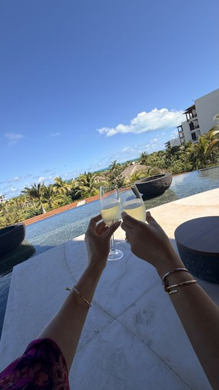</div><div style="grid-column:3;grid-row:1/3;border-radius:12px;overflow:hidden;box-shadow:0 4px 14px rgba(10,10,10,.08);">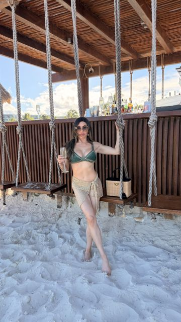</div><div style="grid-column:2;grid-row:2/4;border-radius:12px;overflow:hidden;box-shadow:0 4px 14px rgba(10,10,10,.08);">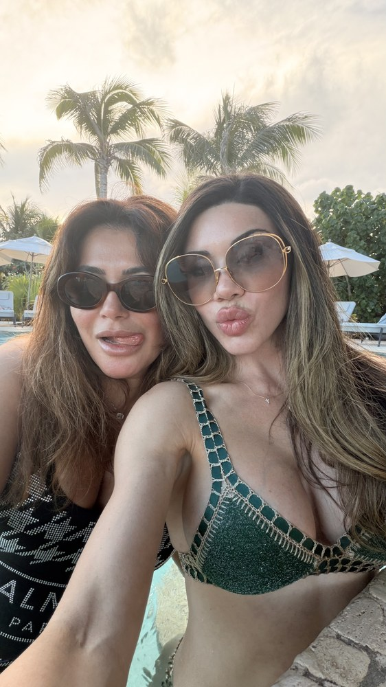</div><div style="grid-column:1;grid-row:3/4;border-radius:12px;overflow:hidden;box-shadow:0 4px 14px rgba(10,10,10,.08);">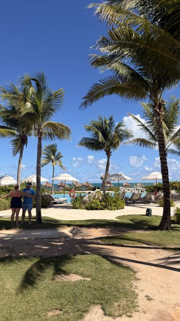</div><div style="grid-column:3;grid-row:3/5;border-radius:12px;overflow:hidden;box-shadow:0 4px 14px rgba(10,10,10,.08);">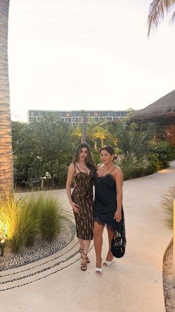</div><div style="grid-column:1;grid-row:4/5;border-radius:12px;overflow:hidden;box-shadow:0 4px 14px rgba(10,10,10,.08);">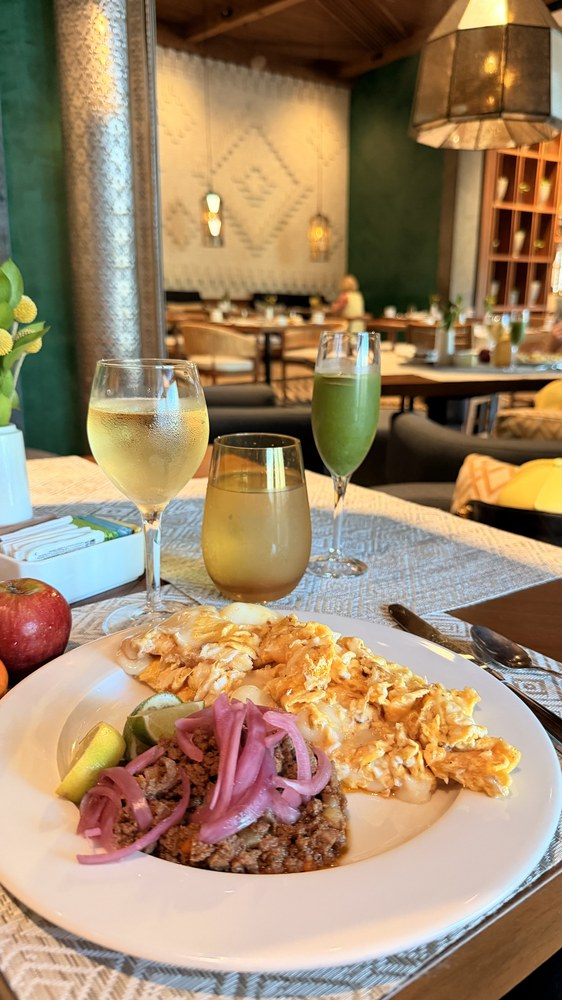</div><div style="grid-column:2;grid-row:4/5;border-radius:12px;overflow:hidden;box-shadow:0 4px 14px rgba(10,10,10,.08);">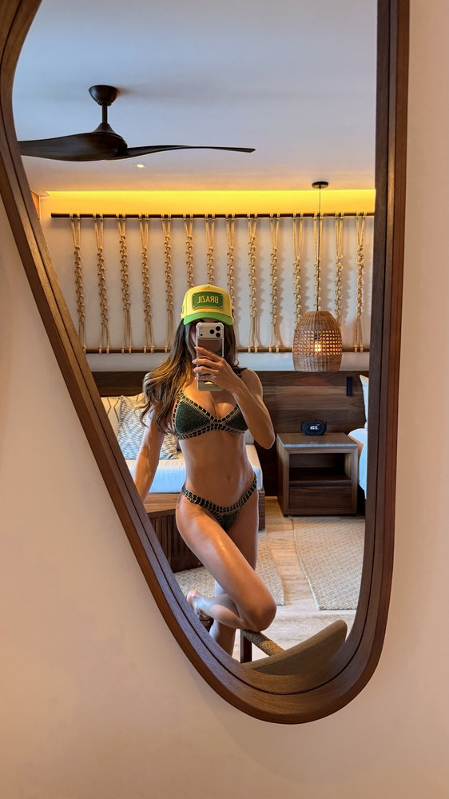</div><div style="grid-column:1;grid-row:5/7;border-radius:12px;overflow:hidden;box-shadow:0 4px 14px rgba(10,10,10,.08);">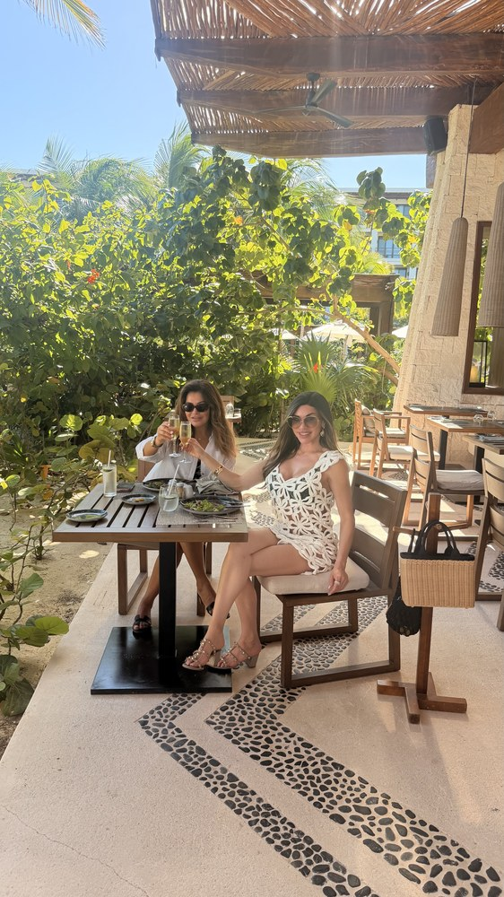</div><div style="grid-column:2;grid-row:5/6;border-radius:12px;overflow:hidden;box-shadow:0 4px 14px rgba(10,10,10,.08);">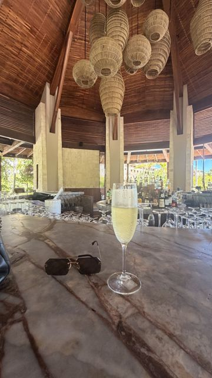</div><div style="grid-column:3;grid-row:5/7;border-radius:12px;overflow:hidden;box-shadow:0 4px 14px rgba(10,10,10,.08);">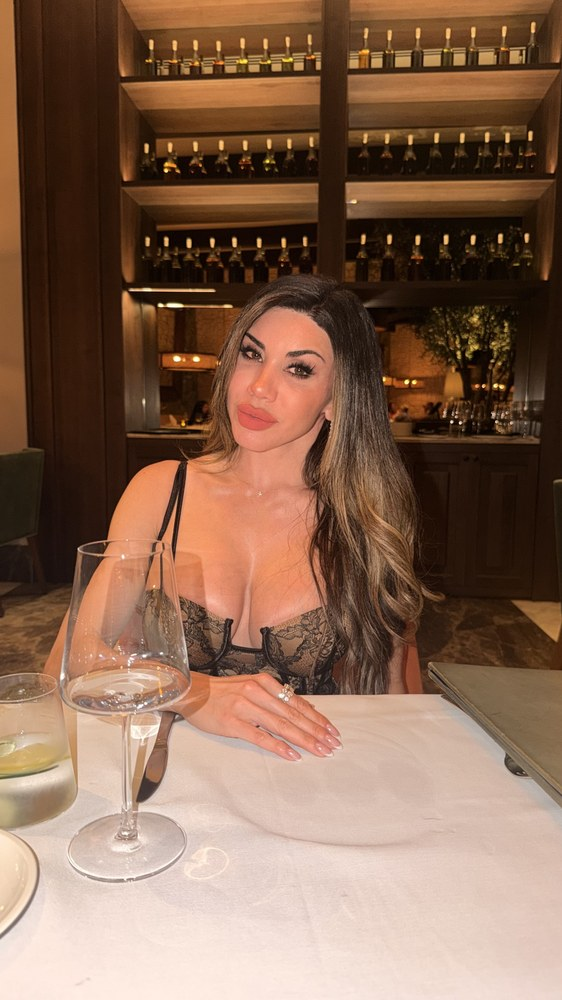</div><div style="grid-column:2;grid-row:6/8;border-radius:12px;overflow:hidden;box-shadow:0 4px 14px rgba(10,10,10,.08);">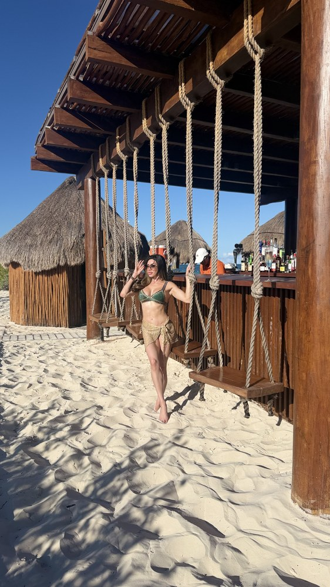</div><div style="grid-column:1;grid-row:7/8;border-radius:12px;overflow:hidden;box-shadow:0 4px 14px rgba(10,10,10,.08);">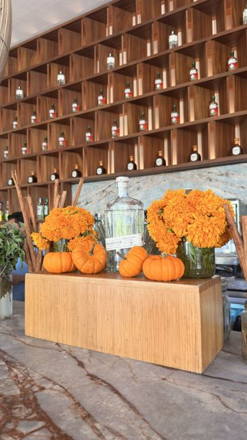</div><div style="grid-column:3;grid-row:7/9;border-radius:12px;overflow:hidden;box-shadow:0 4px 14px rgba(10,10,10,.08);">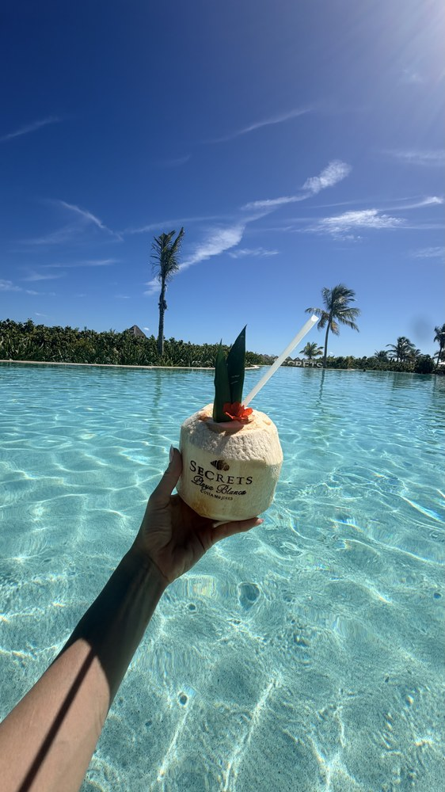</div><div style="grid-column:1;grid-row:8/9;border-radius:12px;overflow:hidden;box-shadow:0 4px 14px rgba(10,10,10,.08);">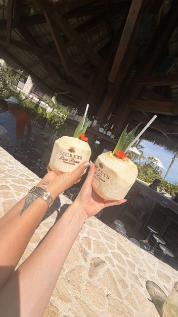</div><div style="grid-column:2;grid-row:8/9;border-radius:12px;overflow:hidden;box-shadow:0 4px 14px rgba(10,10,10,.08);">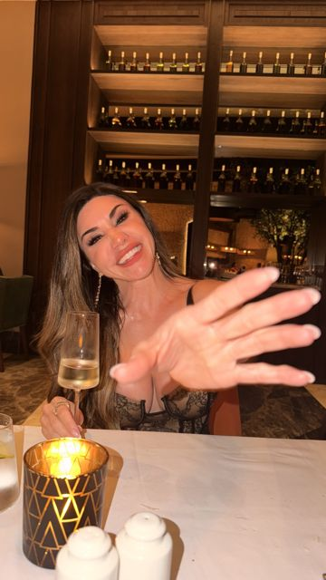</div></div>

<video src="/images/uploads/claude-chrome-extension-resort-tour.mp4" poster="/images/uploads/claude-chrome-extension-resort-tour-poster.jpg" autoplay muted loop playsinline controls style="width:100%;max-width:300px;height:auto;display:block;margin:28px auto;border-radius:18px;box-shadow:0 8px 24px rgba(10,10,10,.12);" aria-label="Room tour of Secrets Playa Blanca Costa Mujeres found with the Claude Chrome extension: the rooftop pool, our room, the infinity pool, the spa courtyard and the pool at sunset."></video>

The food was a 10 out of 10. I have stayed at a lot of all inclusive resorts, and this one beat every restaurant I have tried. The Prosecco was actually good, which is rare. And my favorite spot was the beach bar with the swings. Natural wood, white sand, a drink in my hand and no laptop. I work all the time, so finally sitting still in the sun felt like the real luxury.

## Inside the Spa: My Haven Spa Score

Spa weekends are my favorite way to treat myself. I used to love shopping. Now I would rather spend that money on a peaceful spa weekend somewhere beautiful. So I am starting something new on the blog: every spa I visit gets a **Haven Spa Score**.

Luciene and I booked the couples massage early in the morning. It was relaxing and excellent, and we laughed through a few tequilas afterward. The spa itself, called the Secrets Spa, is about 18,000 square feet with an outdoor hydrotherapy circuit, and it feels earthy and calm, with warm wood, soft lights and a giant woven mirror I could not stop taking photos in.

<div style="margin:32px auto;max-width:520px;background:#FDFBF7;border:1px solid #E8E1D8;border-radius:20px;padding:26px 24px;"><div style="font-size:12px;letter-spacing:.2em;color:#A35F6D;font-weight:700;text-align:center;">✦ HAVEN SPA SCORE</div><div style="font-family:'Playfair Display',serif;font-size:24px;font-weight:800;text-align:center;margin:6px 0 2px;color:#0A0A0A;">Secrets Playa Blanca <em style="color:#C47E8A;">Costa Mujeres</em></div><div style="text-align:center;margin:10px 0 18px;"><span style="font-family:'Playfair Display',serif;font-size:56px;font-weight:800;color:#0A0A0A;line-height:1;">9.5</span><span style="font-size:18px;color:#A35F6D;"> / 10</span></div><div style="display:flex;align-items:center;gap:14px;padding:12px 0;border-top:1px solid #E8E1D8;"><div style="flex:1;"><div style="font-weight:600;color:#0A0A0A;">Spa feel</div><div style="font-size:14px;color:#666;">Earthy, warm and beautiful</div><div style="height:6px;background:#E8E1D8;border-radius:6px;margin-top:8px;"><div style="height:6px;width:90%;background:linear-gradient(90deg,#3D1E25,#C47E8A);border-radius:6px;"></div></div></div><div style="font-family:'Playfair Display',serif;font-size:26px;font-weight:800;color:#0A0A0A;min-width:56px;text-align:right;">9<span style="font-size:14px;color:#A35F6D;">/10</span></div></div><div style="display:flex;align-items:center;gap:14px;padding:12px 0;border-top:1px solid #E8E1D8;"><div style="flex:1;"><div style="font-weight:600;color:#0A0A0A;">Couples massage</div><div style="font-size:14px;color:#666;">Relaxing and excellent</div><div style="height:6px;background:#E8E1D8;border-radius:6px;margin-top:8px;"><div style="height:6px;width:90%;background:linear-gradient(90deg,#3D1E25,#C47E8A);border-radius:6px;"></div></div></div><div style="font-family:'Playfair Display',serif;font-size:26px;font-weight:800;color:#0A0A0A;min-width:56px;text-align:right;">9<span style="font-size:14px;color:#A35F6D;">/10</span></div></div><div style="display:flex;align-items:center;gap:14px;padding:12px 0;border-top:1px solid #E8E1D8;"><div style="flex:1;"><div style="font-weight:600;color:#0A0A0A;">Food and drinks</div><div style="font-size:14px;color:#666;">Best all inclusive food I have had</div><div style="height:6px;background:#E8E1D8;border-radius:6px;margin-top:8px;"><div style="height:6px;width:100%;background:linear-gradient(90deg,#3D1E25,#C47E8A);border-radius:6px;"></div></div></div><div style="font-family:'Playfair Display',serif;font-size:26px;font-weight:800;color:#0A0A0A;min-width:56px;text-align:right;">10<span style="font-size:14px;color:#A35F6D;">/10</span></div></div><div style="display:flex;align-items:center;gap:14px;padding:12px 0;border-top:1px solid #E8E1D8;"><div style="flex:1;"><div style="font-weight:600;color:#0A0A0A;">View and design</div><div style="font-size:14px;color:#666;">Modern, with an ocean view</div><div style="height:6px;background:#E8E1D8;border-radius:6px;margin-top:8px;"><div style="height:6px;width:100%;background:linear-gradient(90deg,#3D1E25,#C47E8A);border-radius:6px;"></div></div></div><div style="font-family:'Playfair Display',serif;font-size:26px;font-weight:800;color:#0A0A0A;min-width:56px;text-align:right;">10<span style="font-size:14px;color:#A35F6D;">/10</span></div></div><div style="font-size:13px;color:#777;text-align:center;margin-top:14px;">Overall score is the average of the 4 ratings. Paid for by me, not sponsored.</div></div>

Why a 9 and not a 10 for the spa? It was beautiful and the massage was great, but I have been to 1 spa in Mexico that made me say "wow" out loud. I am saving that one for its own review soon, so you will see what a 10 looks like.

<div style="margin:32px 0 8px;font-size:12px;letter-spacing:.2em;color:#A35F6D;font-weight:700;">✦ INSIDE THE SPA</div>

<div style="display:grid;grid-template-columns:repeat(3,1fr);grid-auto-rows:clamp(96px,28vw,150px);gap:8px;max-width:520px;margin:8px auto 28px;"><div style="grid-column:1;grid-row:1/3;border-radius:12px;overflow:hidden;box-shadow:0 4px 14px rgba(10,10,10,.08);border:2px solid #C47E8A;">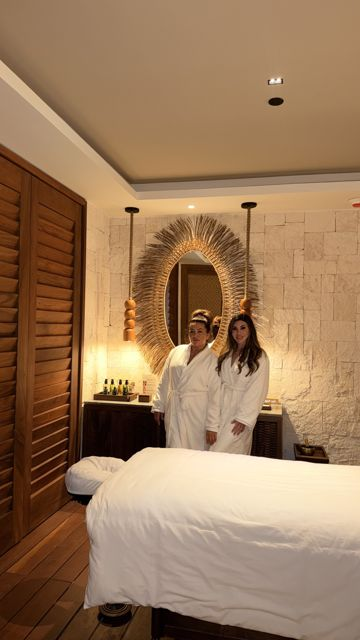</div><div style="grid-column:2;grid-row:1/2;border-radius:12px;overflow:hidden;box-shadow:0 4px 14px rgba(10,10,10,.08);border:2px solid #C47E8A;">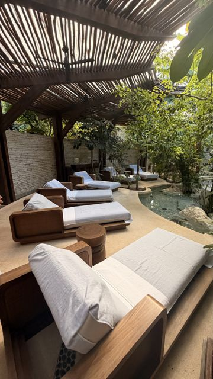</div><div style="grid-column:3;grid-row:1/2;border-radius:12px;overflow:hidden;box-shadow:0 4px 14px rgba(10,10,10,.08);border:2px solid #C47E8A;">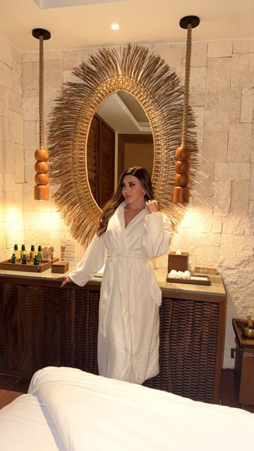</div><div style="grid-column:2;grid-row:2/4;border-radius:12px;overflow:hidden;box-shadow:0 4px 14px rgba(10,10,10,.08);border:2px solid #C47E8A;">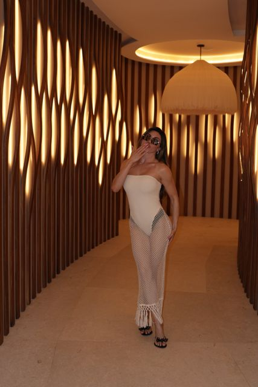</div><div style="grid-column:3;grid-row:2/3;border-radius:12px;overflow:hidden;box-shadow:0 4px 14px rgba(10,10,10,.08);border:2px solid #C47E8A;">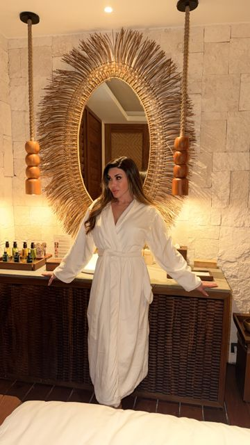</div><div style="grid-column:1;grid-row:3/4;border-radius:12px;overflow:hidden;box-shadow:0 4px 14px rgba(10,10,10,.08);border:2px solid #C47E8A;">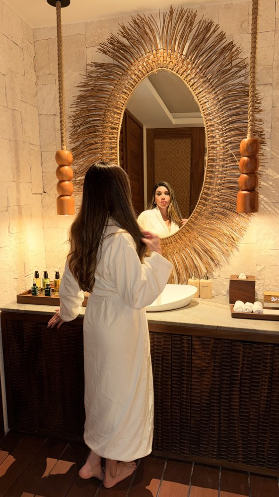</div><div style="grid-column:3;grid-row:3/4;border-radius:12px;overflow:hidden;box-shadow:0 4px 14px rgba(10,10,10,.08);border:2px solid #C47E8A;">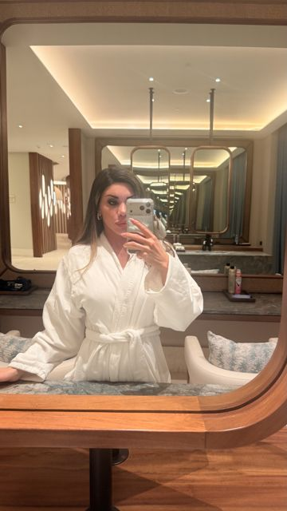</div></div>

## A Little Note for Luciene

We have been friends for 9 years. Ups and downs, like any real friendship, but mostly ups. She has always been there for me, and she feels like home. We talked about this trip for years, and this Halloween we finally made it happen, even if it was only 1 quick night because she had to get back to work.

Luciene, thank you for being a true friend. This was the best time, and we are doing it again.

Honestly, the only hard part is that I don't love traveling alone yet. Next time, maybe my dog Lucky comes with me. We shall see.

## How to Use AI to Plan a Trip: Your Turn

You do not need to be a tech person to do this. Here is the simple version:

1. **Install Claude in Chrome** from the Chrome Web Store and pin it to your toolbar.
2. **Open your booking site** first, like Expedia, so Claude starts in the right place.
3. **Say your wish list out loud**, the way you would tell a friend. Budget, flight time, style and must haves.
4. **Ask for the top 3** with prices and ratings, so you can compare.
5. **Tell it to stop at checkout.** Always check the dates, names, room and total yourself before you pay.

If you want to go further, I show how I set Claude up to run real parts of my business in [how to create an AI agent with Claude](https://lisahaven.co/blog/how-to-create-an-ai-agent-with-claude/), and the full stack I use every day is in [AI tools for entrepreneurs](https://lisahaven.co/blog/ai-tools-for-entrepreneurs/).

**Tools I used for this trip:** [Claude in Chrome](https://claude.com/chrome) and [Expedia](https://www.expedia.com/). No affiliate links here, just the tools I really used.

I am using AI to plan my next spa day too. For my daughter Mili's birthday next week, I am taking her to a local spa, and Claude is already hunting for the best specials.

**Want my next spa review and the prompts I use to plan every trip?** [Join The Haven](https://lisa-haven.beehiiv.com/subscribe?ref=blog-claude-chrome-extension), my free weekly letter on building a life and a business with AI.

## FAQ

**Can the Claude Chrome extension book a hotel for me?**
Yes. It can search a site like Expedia, use the filters, compare options and fill in the booking steps. I asked it to stop at the checkout page so I could check everything and pay myself, and I recommend you do the same.

**Is the Claude Chrome extension free?**
The extension is free to install from the Chrome Web Store, but you need a paid Claude plan to use it.

**Is Secrets Playa Blanca Costa Mujeres adults only?**
Yes. It is an adults only resort, so guests must be 18 or older. That is the only reason my daughters did not come with me.

## Your Turn

Would you let AI plan your next vacation? Tell me in the comments: **all the way to checkout, ideas only, or never?** And if you have a spa I need to review, drop it below. I am building my list of the best hotel spas in the world.

> "Rest is not a reward. It is part of the work."
