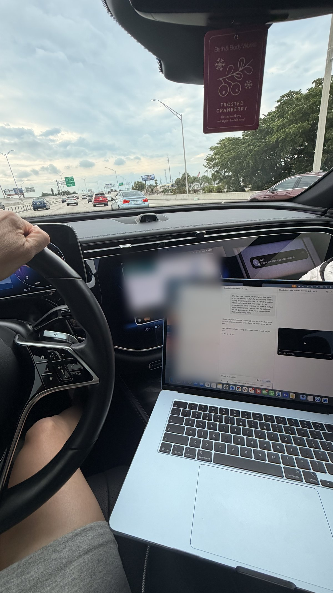
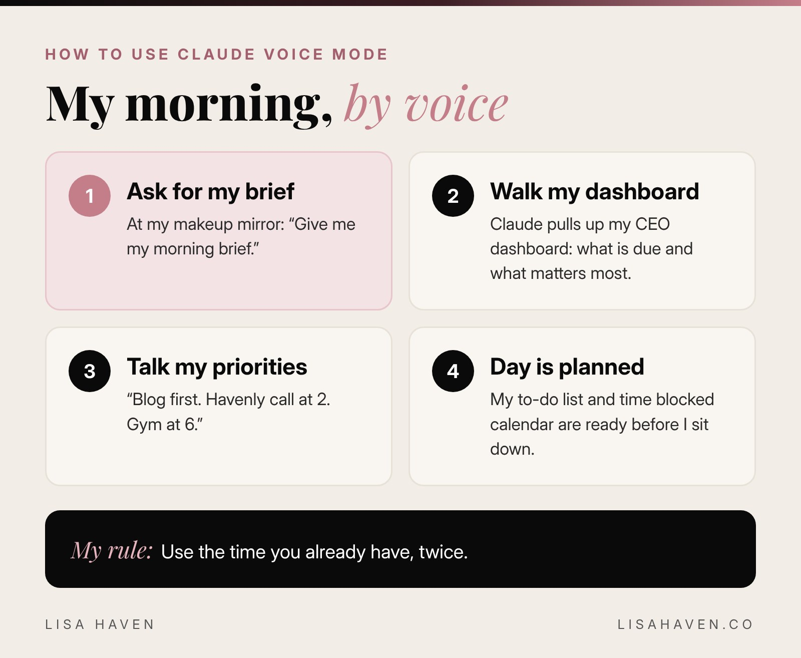
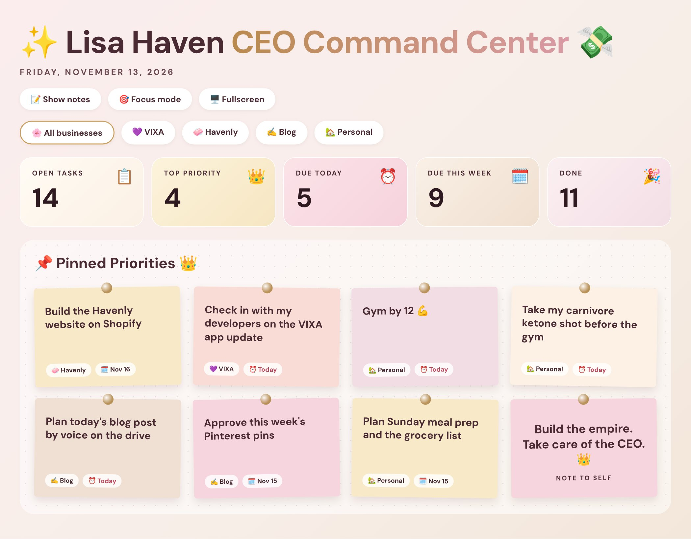

Today I planned 2 blog posts without touching my keyboard. I was driving for about an hour to a photo shoot for Havenly and my blog, and I talked the whole way. Topics, stories, my opinions, the details. By the time I parked, both posts were planned.



*The real moment: Claude in voice mode on the passenger seat while I drove. I just talked, eyes on the road.*

That is how I use Claude voice mode. And once you learn it, you will never look at "I don't have time" the same way again.

So, how do you use Claude voice mode? **Open the Claude app, tap the voice button next to the message box, pick a voice, and start talking. Claude listens, answers out loud, and saves the whole conversation as text in your chat.** That is it. The magic is in what you ask it to do.

Here is exactly how I use it every morning as a mother of 3 running 3 companies, the settings I changed, and the prompts I use.

**Key takeaways:**

- Claude voice mode is a full, spoken conversation. You talk, Claude talks back, and everything is saved as a normal chat.
- It is on every Claude plan, including free, on your phone, computer and the web. It works best on your phone.
- I use it every morning while doing my makeup to get my brief, my CEO to-do list and my time blocked calendar.
- Use the right AI for the right job. I use Claude for my files, writing and building. I use ChatGPT for research and images.

## Why I talk to Claude instead of typing

I will be honest. I used to always be late. Always rushed. There was never enough time.

I get ready every single day. Makeup on, gym clothes on, put together. I put a lot of work into myself, and I am not going to stop. But getting ready used to fight with everything else: breakfast, the girls, and actual work. Something always lost.

Now I do both at the same time. While I do my makeup, I talk to Claude. I make my to-do list and time block my calendar by voice, before I even sit down at my desk. By the time my lipstick is on, my day is planned.

That is the real reason voice mode changed my life. It does not give me more hours. It lets me use the hours I already have, twice.

## Why Claude, and not ChatGPT, for voice

I use both. I am not loyal to 1 app. I am loyal to what works.

- **Claude** holds my files, my projects and my businesses. It is where I write, where I build my blog, and where my whole CEO system lives. So when I talk to it, it already knows what I am working on.
- **ChatGPT** is where I go for research and for making images.

I wrote a full breakdown of when I use each one in [Claude vs ChatGPT](https://lisahaven.co/blog/claude-vs-chatgpt/). The short version: pick the right AI for each job, and stop trying to make 1 tool do everything.

For voice, Claude wins for me because all of my files are already there. That matters more than anything else.

## My morning brief, by voice

Here is what my mornings look like now.

I sit down at my makeup mirror, open the Claude app on my phone, and tap voice. Then I ask for my morning brief and my CEO to-do list. Claude pulls up my CEO dashboard and walks me through it: what is due, what is waiting on me, and what matters most today.

Then I talk through my day out loud. "Move the Havenly call to 2. Put blog writing first. I have the gym at 6." Claude builds the plan with me as I go.



Here is the prompt I use to start. You can say it out loud, or paste it in once and just say "morning brief" after that:

```prompt
Good morning. Give me my morning brief.
First, tell me the 3 most important things for my business today.
Then build my to-do list, with the hardest and most important task first.
Ask me what time I start, what appointments I have, and when I work out.
Then time block my day for me, with breaks, and keep each block realistic.
Keep your answers short, since I am getting ready while we talk.
```

Tip: the last line matters. In voice mode, long answers feel even longer. Ask for short answers and Claude will keep it moving.

## My school pickup drive is my second office

Picking up my girls from school is about 1 hour in the car, every single day. That hour used to feel lost. Now it is one of my most productive parts of the day.

I talk to Claude the whole way. (Hands on the wheel, eyes on the road. I talk, I do not read.) Here is what I usually cover:

- **My bots and my team.** I check on the AI bots that answer my creators, ask how my creator manager is doing, and tell Claude what to update in the bot.
- **Blog ideas.** Half of my blog titles start as a random thought in the car.
- **What is trending and what is coming.** I ask what is changing in AI, in dating apps and in beauty, so I stay ahead.
- **What my business needs next.** My next steps, what I am forgetting, and who I could collaborate with.

I am always chatting. And honestly? I love that it never gets tired of me. I can think out loud for an hour, change my mind 5 times, and it is still right there with me.

Here is a prompt for your own drive:

```prompt
I am driving for the next hour, so keep every answer short and spoken, no lists.
Ask me 1 question at a time.
First, help me check on my business: what did I start this week that I have not finished?
Then ask me what is on my mind, and help me turn it into 3 clear next steps.
At the end, give me a 3 line recap I can read later when I park.
```

## The coolest thing I built by voice

My CEO dashboard and to-do list.

I am very structured. I like knowing exactly what my week looks like before it starts. So I built a CEO dashboard with Claude, mostly by talking to it. It holds my priorities for VIXA, Havenly and LUMAPROMPT.AI, my deadlines, and my to-do list.

Now it is the foundation of my whole week. Every morning I ask about it, and every Sunday I plan the next week from it.



*My CEO Command Center, built with Claude. This is a sample version: I swapped my real to-do list for everyday tasks to keep my business plans private.*

When I ask Claude by voice to update it, we go over it together. "Move the Shopify site to Monday. Mark the developer check-in done. Add gym by 12." It reads my list, changes it, and tells me what is left.

You do not need to be technical to build your own. Start with this:

```prompt
Help me build a simple CEO dashboard for my week.
My businesses or main projects are: [list them].
For each one, ask me for my top goal this month and my 3 next steps.
Then make me 1 weekly view with my priorities, my deadlines and my to-do list.
Keep it simple enough that I can check it every morning in 2 minutes.
Ask me 1 question at a time, since I am talking to you by voice.
```

"Ask me 1 question at a time" is the secret for voice. It turns a long form into an easy conversation.

## How to use Claude voice mode, step by step

Here is how to start, even if you have never used it:

1. **Download the Claude app.** Voice mode is on every plan, including free. It works on your phone, your computer and the web, but [Anthropic says it works best on your phone](https://support.claude.com/en/articles/11101966-using-voice-mode).
2. **Open a new chat and tap the voice button.** It sits next to the message box.
3. **Pick a voice.** Claude asks you the first time. You can change it later in settings.
4. **Choose how you talk.** Hands free is great in a quiet room. Push to talk is better in the car or a noisy kitchen, because Claude only listens while you hold the button.
5. **Connect your apps.** In voice mode, Claude can use the tools you connect, like Gmail, Google Calendar, Google Docs and Slack. This is how it can read your calendar and help you plan for real.
6. **Just talk.** You do not need to speak slowly. Talk like you would to a friend.
7. **Go back and read it later.** Every voice chat is saved as text, so nothing gets lost.

Quick difference that confuses a lot of people: **dictation** turns your words into typed text you can send. **Voice mode** is a full back and forth conversation. Claude has a simple guide on [when to use voice mode or dictation](https://claude.com/resources/tutorials/how-to-choose-between-voice-mode-and-dictation). I use voice mode for planning and thinking, and dictation when I already know what I want to say.

## The downside (honest moment)

I have a slight accent. Sometimes Claude hears a word wrong. To be fair, ChatGPT understands my voice a little better.

But here is what I love about Claude: it does not cut me off. I can pause, think, and finish my sentence. When you are planning your whole day, that matters a lot.

If you have an accent too, here is what helps me:

- Use push to talk in noisy places, like the car.
- If a word comes out wrong, just correct it out loud: "I said Havenly, not heavenly." Claude fixes it and moves on.
- Glance at the text on screen for names and numbers. Those are the words most likely to get mixed up.
- Teach it your words once. Tell Claude the names of your businesses, your kids and your clients at the start of a chat.

Voice mode also counts toward your normal Claude usage limits, so on the free plan you get a limited number of messages before you need a break.

## 5 ways busy moms can use voice mode today

1. **While getting ready:** your morning brief, to-do list and time blocked calendar.
2. **While driving:** plan content, think through a big decision, or prep for a meeting. (Eyes on the road. Talk, do not read.)
3. **While cooking:** plan the week's meals and build the grocery list.
4. **While folding laundry:** brain dump everything in your head, then ask Claude to sort it into "today," "this week" and "later."
5. **Before bed:** a 5 minute recap of what you got done and what moves to tomorrow.

If you want typed prompts for mom life too, my [ChatGPT prompts for busy moms](https://lisahaven.co/blog/chatgpt-prompts-for-busy-moms/) work in Claude as well.

## My best advice: mess with everything

If you are a mom who wants to start, here is my advice. Do not just watch videos about it. Mess with everything.

Go into all the settings. Change the voice. Try hands free, then try push to talk. Connect your calendar. Customize everything. And then just start talking to Claude.

That is literally how I started. I did not take a course. I opened the app, pressed every button, and talked. Every week I learned 1 new thing, and now it runs my mornings.

## Tools I use for my voice routine

*Some links below may be affiliate links, which means I may earn a small commission at no extra cost to you. I only share tools I really use.*

- **[Claude](https://claude.ai):** my voice partner every morning, and where all my files and my CEO dashboard live.
- **[ChatGPT](https://chatgpt.com):** my go-to for research and making images.
- **[Google Calendar](https://calendar.google.com):** connected to Claude, so my time blocks land on my real calendar.
- **[Monday.com](https://monday.com):** where my bigger projects and team tasks live.

## Your next step

Tomorrow morning, before you get ready, open the Claude app and say the morning brief prompt above out loud. Just 1 morning. See how it feels to start your day already planned. And if you want to see what else I hand to AI, read my list of [AI tools for entrepreneurs](https://lisahaven.co/blog/ai-tools-for-entrepreneurs/) or how I use the [Claude Chrome extension](https://lisahaven.co/blog/claude-chrome-extension/) to book a whole trip.

**Want my real AI routines in your inbox?** [Join The Haven](https://lisa-haven.beehiiv.com/subscribe?ref=blog-how-to-use-claude-voice-mode), my free weekly letter on building a life and a business with AI.

## FAQ

**Is Claude voice mode free?**
Yes. Voice mode is available on every Claude plan, including free. Voice chats count toward your normal usage limits, so free plans get fewer messages before a break.

**Where is voice mode in the Claude app?**
Open a chat and tap the voice button next to the message box. The first time, Claude asks you to pick a voice.

**What is the difference between voice mode and dictation in Claude?**
Dictation turns your speech into text that you send. Voice mode is a full spoken conversation where Claude talks back.

**Can Claude voice mode read my calendar?**
Yes, if you connect it. In voice mode, Claude can use connected tools like Google Calendar, Gmail, Google Docs and Slack.

**Does Claude voice mode understand accents?**
Mostly, yes. It sometimes hears a word wrong. Push to talk, a quiet room and correcting it out loud all help.

## Before you go

Tell me in the comments: **do you talk to your AI or type to it?** Reply A for "I talk," B for "I type," or C for "I did not know I could talk to it." I read every single comment. 🖤

> "You do not need more time. You need to use the time you already have, twice."
