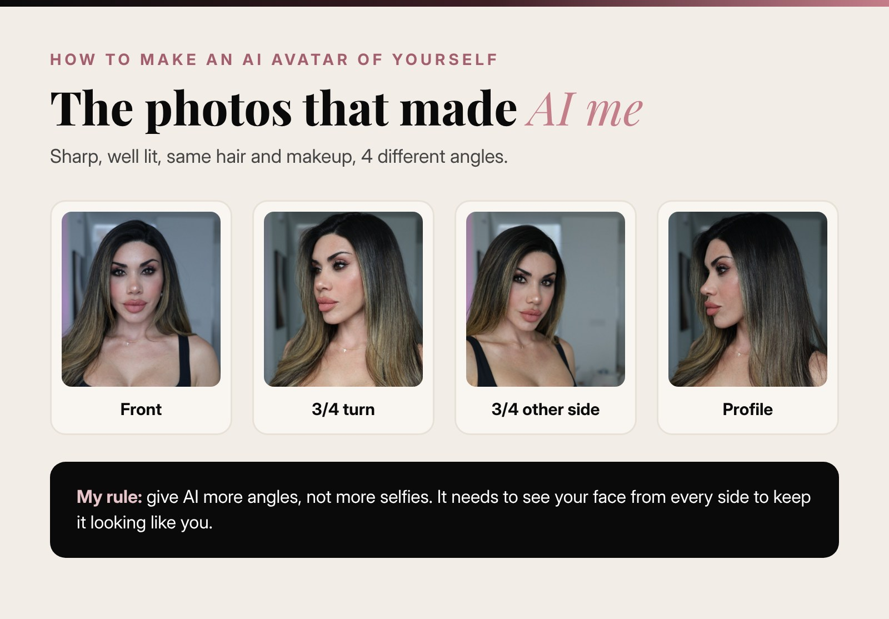
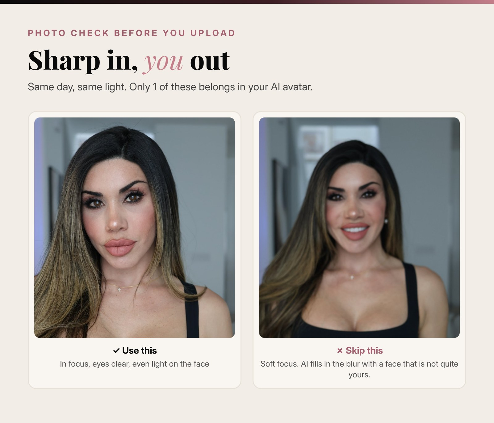
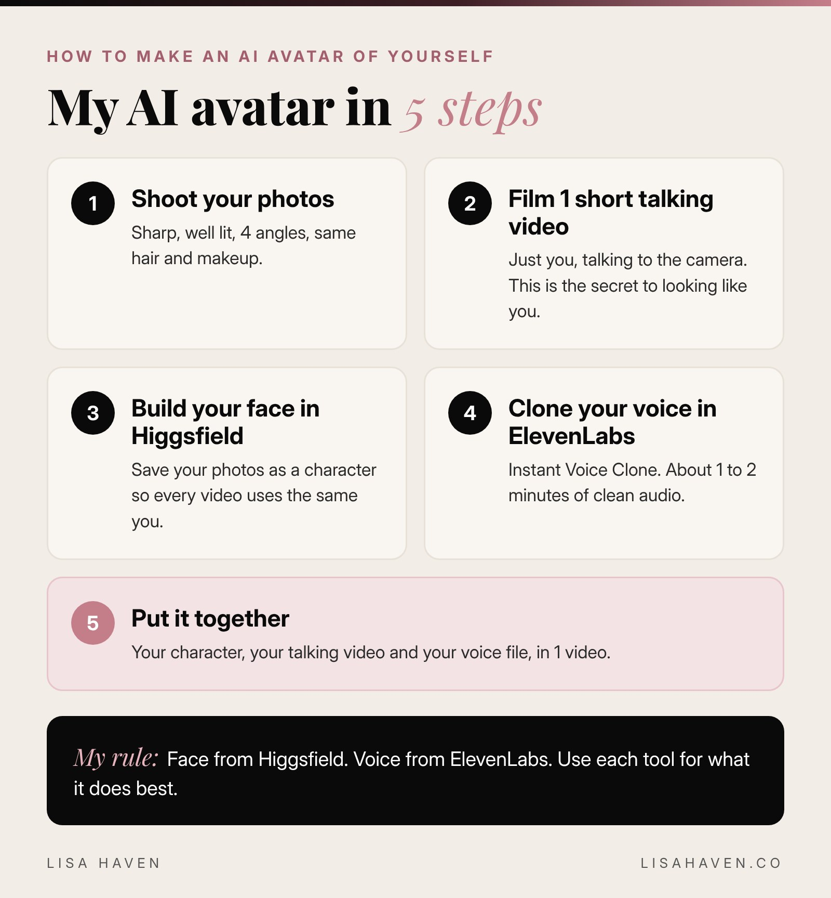

I did not want to keep filming myself.

Hair, makeup, lighting, 12 takes, and then I still hate how I said the second sentence. I run 3 companies and I am a mom of 3. I do not have time to be on camera every day. So I made an AI version of me instead.

The first time I saw it, I could not believe it. It looked exactly like me.

So, how do you make an AI avatar of yourself? **Shoot a few sharp photos of your face from different angles, film 1 short video of yourself talking, and upload them to an AI video tool like Higgsfield. Then clone your voice in ElevenLabs and give your avatar a script.** That is the whole recipe. The details are what make it look like you, and not like your cousin.

Here is exactly how I did it, what went wrong, and my real before and after.

**Key takeaways:**

- You need 3 things: sharp photos, 1 short talking video and a clean voice recording.
- I use Higgsfield for my face and ElevenLabs for my voice. Each one is the best at its own job.
- The talking video matters more than anything. Photos alone gave me a version that did not look like me.
- Label your AI videos honestly. Your audience should always know.

## Why I made an AI version of myself

Content is the engine of every business I run. But filming is the part I always push to tomorrow.

I will be honest. I have always been a little scared of people judging me on camera. Making an AI me is how I keep showing up, even on days when I have no makeup on and a toddler on my hip.

I still write every script myself. AI just gives me the face and the voice, so I can post more without filming more.

## What you need before you start

Gather these first. It saves you hours of redoing things later.

1. **10 to 20 sharp photos of your face.** Front, both 3/4 turns and both profiles. Same hair and makeup in all of them.
2. **1 short video of you talking to the camera.** Good light, phone on a tripod, about 10 to 15 seconds. This is your avatar's "how she moves" file.
3. **1 to 2 minutes of your voice.** Read anything out loud in a quiet room. This is for your voice clone.
4. **A Higgsfield account** for the video, and **an ElevenLabs account** for the voice.

I did my whole shoot at home, with the camera on a tripod and my hair straight.



## Step 1: Shoot photos AI can actually learn from

Your AI avatar can only be as good as your photos. Here is what I learned:

- **Sharp beats pretty.** If a photo is even a little blurry, skip it. AI fills in the blur with a face that is not quite yours.
- **Angles beat quantity.** 4 angles teach AI more than 20 selfies from the same side.
- **Keep the look the same.** Same hair, same makeup, same lighting. Mixed looks confuse it.
- **Even light on your face.** Stand facing a window, or use a ring light.

I took a lot of photos that day, and some of them came out soft. That is normal. Just do not upload them.



## Step 2: Build your face in Higgsfield

[Higgsfield](https://higgsfield.ai) is the AI video tool I use. Here is how I set up my face:

1. **Upload your photos and save them as a character.** Higgsfield calls this an Element. I named mine after me. Now every video I make uses the same face.
2. **Upload your talking video too.** This is the step most people skip.
3. **Write your prompt.** Describe the room, your outfit and what you say. Then tell it to use your character for your face and your video for how you move and talk.

Here is the prompt structure I use. Fill in the brackets:

```prompt
[Your character] sitting in [the room: a bright podcast studio, a home office, a kitchen].
Use the photos of [your character] for her face and look, and the uploaded video for how she moves and talks.
She wears [your outfit], hair [how you wear it], [your makeup].
She talks to the camera with natural hand moves, confident and smiling.
She says: "[your script, 1 to 2 short sentences]"
Slow push-in camera, shallow depth of field, ultra realistic.
```

Keep the script short. About 8 to 10 seconds is the sweet spot for each clip.

## The voice problem nobody warns you about

My first video looked exactly like me. My face, my smile, the way I move my hands. I was so excited.

Then I heard it talk. It was not my voice. Not even close.

I tried Higgsfield's voice tools over and over. Slower, faster, different settings. The voice dragged, it was too slow, and it never sounded like me. I have a slight Brazilian accent, and it just could not get me.

Here is that very first video. Watch it with the sound on:

<video src="/images/uploads/how-to-make-an-ai-avatar-of-yourself-before.mp4" poster="/images/uploads/how-to-make-an-ai-avatar-of-yourself-before-poster.jpg" controls playsinline preload="metadata" style="width:100%;height:auto;display:block;margin:28px 0 10px;border-radius:16px;box-shadow:0 8px 24px rgba(10,10,10,.12);" aria-label="My first AI avatar test video from Higgsfield: AI me in a dark podcast studio. The face looks like me, but the voice does not."></video>

*Test video only. This was my very first AI me, made just to see how it looks. What I say here was for testing. But hey, I'm manifesting it.*

So I stopped trying to make 1 tool do everything.

## Step 3: Clone your voice in ElevenLabs

[ElevenLabs](https://elevenlabs.io) is the voice tool I use, and it is the most accurate one I have tried. Here is how I cloned my voice:

1. **Go to Voices and click the plus button.** Pick **Instant Voice Clone**.
2. **Upload or record your audio.** ElevenLabs recommends [1 to 2 minutes of good audio](https://elevenlabs.io/docs/eleven-creative/voices/voice-cloning/instant-voice-cloning) in MP3.
3. **Name your voice and save it.** I named mine Lisa Haven.
4. **Test it in Text to Speech.** Type a sentence, pick your voice and click Generate.

Here is the surprising part: more audio is not always better. ElevenLabs says that [more than 2 to 3 minutes of audio adds little](https://elevenlabs.io/docs/help-center/product/voice-customization/voice-cloning/how-many-voice-samples-should-i-upload-for-instant-voice-cloning), and it can even make the clone less stable. Talk the way you want your avatar to sound, too. If you read slowly in a flat voice, your clone will copy that.

The first time I heard my clone, I said "this is perfect." It is as close to my real voice as it gets.

## Step 4: Put your face and your voice together

Now the fun part. Here is my exact workflow:

1. **In ElevenLabs,** type your script, generate it in your cloned voice and download the MP3.
2. **In Higgsfield,** start a new video with your character, your talking video and that MP3 as the audio reference.
3. **Use the same prompt structure** from Step 2. Add 1 line: "Her voice is the uploaded reference audio, word for word, perfectly lip synced."
4. **Generate and watch it with the sound on.** If something is off, change 1 thing at a time.

Here is the same script as my test video, made the new way. Same face, a lighter studio, and my real ElevenLabs voice:

<video src="/images/uploads/how-to-make-an-ai-avatar-of-yourself-after.mp4" poster="/images/uploads/how-to-make-an-ai-avatar-of-yourself-after-poster.jpg" controls playsinline preload="metadata" style="width:100%;height:auto;display:block;margin:28px 0 10px;border-radius:16px;box-shadow:0 8px 24px rgba(10,10,10,.12);" aria-label="My AI avatar made with Higgsfield and my ElevenLabs voice clone: AI me in a bright podcast studio, looking and sounding like me."></video>

*After: Higgsfield for my face, ElevenLabs for my voice. Same script, so you can hear the difference.*



## Why your AI avatar does not look like you

This happened to me today, while making this post.

I tried to remake my video using only 1 photo. The result looked nothing like me. Same tool, same character, a totally different face.

The fix was my talking video. Once I added it back, AI me was back too. Photos teach AI your face. The video teaches it how your face moves when you talk, and that is what makes it feel like you.

If yours looks off, check these:

- **Did you include your talking video?** This is the number 1 fix.
- **Are any photos blurry or from a different look?** Remove them.
- **Is your prompt fighting your photos?** If you ask for curly hair and every photo is straight, the face can drift.
- **Did you change too many things at once?** Change 1 setting, generate, compare.

## Should you label your AI avatar?

Yes. Always.

I never want my readers to feel tricked. When I post AI me, I say it is AI. It does not make the content less valuable. It makes you more trustworthy, and it shows other women what is possible.

Protect your voice, too. Keep your voice clone private and only use it for your own content. And only ever clone your own face and voice, never someone else's.

## Tools I use for my AI avatar

*Some links below may be affiliate links, which means I may earn a small commission at no extra cost to you. I only share tools I really use.*

- **[Higgsfield](https://higgsfield.ai):** my AI video tool. It makes AI me look exactly like me.
- **[ElevenLabs](https://elevenlabs.io):** my voice clone. The most accurate voice I have tried.
- **[Claude](https://claude.ai):** where I write my scripts and plan my content. Here is how I choose between [Claude vs ChatGPT](https://lisahaven.co/blog/claude-vs-chatgpt/).

Want the full list? Here are the [AI tools for entrepreneurs](https://lisahaven.co/blog/ai-tools-for-entrepreneurs/) I use to run all 3 of my companies.

## Your next step

This week, do just Step 1. Set your phone on a tripod by a window, take sharp photos from 4 angles, and film 1 short video of yourself talking. That is the hardest part, and you only do it once.

Then write your first script. If you want help sounding like yourself, read how I [use AI without sounding like AI](https://lisahaven.co/blog/how-to-use-ai-without-sounding-like-ai/). And if you want ready-made prompts written by real experts, [LUMAPROMPT.AI](https://www.lumaprompt.ai/?utm_source=lisahaven&utm_medium=blog&utm_campaign=how-to-make-an-ai-avatar-of-yourself) has you covered.

**Want my real AI routines in your inbox?** [Join The Haven](https://lisa-haven.beehiiv.com/subscribe?ref=blog-how-to-make-an-ai-avatar-of-yourself), my free weekly letter on building a life and a business with AI.

## FAQ

**Can I make an AI avatar of myself for free?**
You can test for free on some tools, but realistic video with your own face usually needs a paid plan. Each short clip uses credits, so plan your scripts before you generate.

**How many photos do I need for an AI avatar?**
Quality matters more than quantity. 10 to 20 sharp photos from different angles, plus 1 short talking video, worked best for me.

**How do I make my AI avatar sound like me?**
Clone your voice in ElevenLabs with 1 to 2 minutes of clean audio. Then generate your script in your voice and upload that audio to your video tool.

**Is it legal to make an AI avatar of yourself?**
Using your own face and voice for your own content is generally fine. Never clone someone else without their permission, and always label your AI content.

## Before you go

Tell me in the comments: **would you use an AI version of yourself?** Reply A for "Yes, today," B for "Maybe, it scares me a little," or C for "No, I love filming." I read every single comment. 🖤

> "Done is better than perfect, and AI just made done a whole lot easier."
