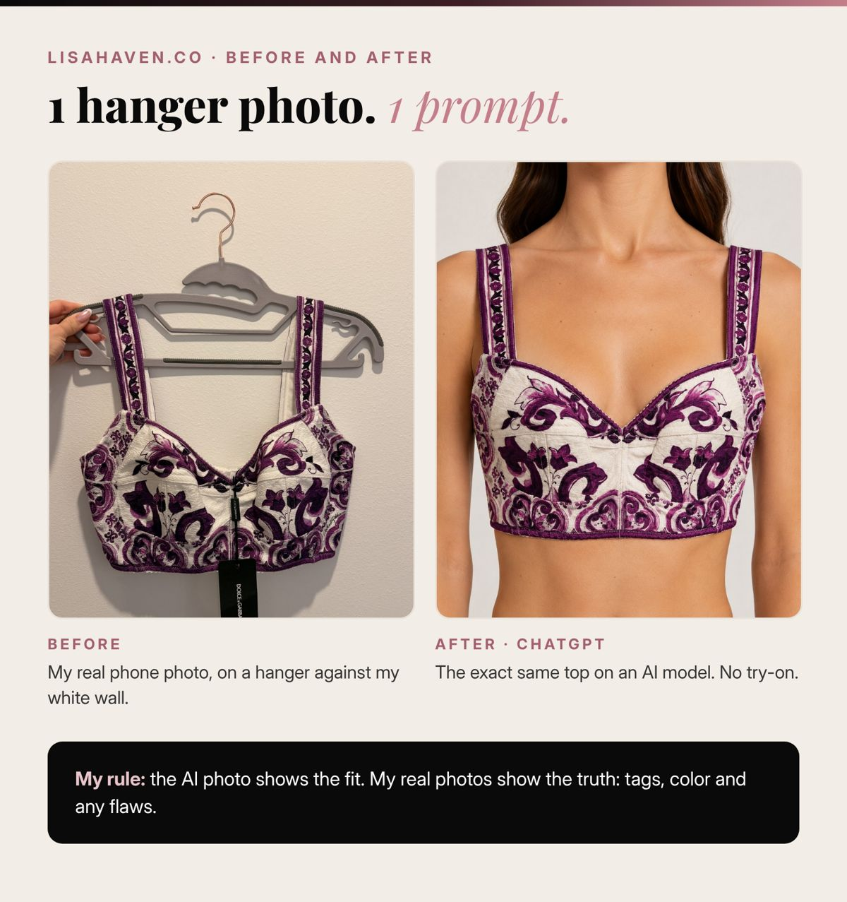
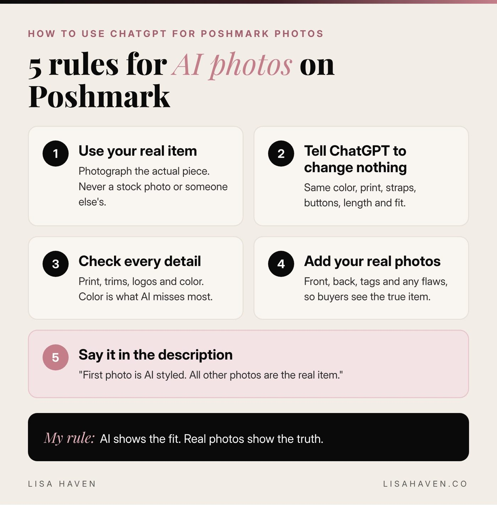

Tonight I hung a top on a hanger, held it up against my white wall and took 2 photos with my phone. That was the whole photo shoot.

Then I opened ChatGPT, uploaded the photos and asked it to put the top on a model. A few seconds later I had a clean, boutique style photo of the exact same top on a body. No mirror selfies. No trying it on. No changing 6 times between listings.

So, how do you use ChatGPT for Poshmark photos? **Take a clear photo of your item on a plain background, upload it to ChatGPT, and ask it to put that exact item on a model without changing anything. Then use your real photos for every other picture in the listing, so buyers see the true item, the tags and any flaws.** That is the whole trick. The prompt and the rules are what make it work.

Here is exactly how I do it, my real before and after, and how to keep your account safe.

**Key takeaways:**

- 1 photo on a hanger and 1 prompt is all you need.
- The prompt matters. Tell ChatGPT to keep every detail of the item exactly the same.
- Always check the AI photo against your real item, especially the color.
- Keep your real photos in the listing. Poshmark requires original photos of the item.

## Why I stopped trying on clothes for listings

I used to be a professional photographer. I know what a great product photo looks like, and I know how long it takes.

Clothes sell better on a body. Buyers want to see the fit, the shape and how it looks on a real person. But I run 3 companies and I am a mom of 3. Doing my hair and makeup just to model a top for a resale listing is not happening.

So now ChatGPT is my model. I still take every real photo myself. AI just gives me the "on a body" shot I never had time for.

## What you need before you start

Gather these first:

1. **The item, clean and steamed.** AI copies wrinkles too.
2. **A hanger and a plain wall.** White or cream is best. Mine is a simple white wall at home.
3. **Good light.** Stand near a window during the day. Avoid yellow lamps at night if you can.
4. **ChatGPT.** I use the ChatGPT app on my phone, so everything happens in 1 place.

## Step 1: Take your hanger photo the right way

Your AI photo can only be as good as the photo you give it. Here is what I do:

- **Shoot straight on.** Hold your phone at the same height as the item, not from above.
- **Show the whole item.** Straps, edges and hem all in the frame.
- **Take the front and the back.** I take both, so I have real photos for the listing too.
- **Keep the tags on if it is new.** They prove it in your real photos.

Here is my real photo from tonight, and what ChatGPT made from it:



*Before: my real phone photo. After: ChatGPT put the exact same top on an AI model.*

## Step 2: Use the right ChatGPT prompt

This is the step that makes or breaks it. If you just say "put this on a model," ChatGPT might change the print, the color or the shape.

Here is the exact prompt I typed tonight. Upload your photo, then paste it in:

```prompt
Generate me two images of a model with a head cut off wearing this top. Make sure it looks identical to the photo. Do not change anything about the top. Just put it on a model with the head cut off and the bottom cut off. Just show the top, front and back. So two images.
```

Why I ask for the head cut off: it keeps the focus on the item, and buyers are not distracted by a face. It also looks like the photos big boutiques use.

Want a cleaner version you can reuse for any item? Fill in the brackets:

```prompt
Put this exact [item: top, dress, jacket] on a realistic model. Keep every detail of the clothing exactly the same: color, print, fabric, buttons, straps, length and fit. Do not add, remove or change anything on the clothes. Crop the photo just below the chin, so no face shows. Plain light studio background, soft natural light, front facing. Square photo, 1:1.
```

Here is the surprising part: [Poshmark crops uploaded photos to a square](https://www.insmind.com/blog/how-to-sell-on-poshmark), no matter what shape you upload. So ask ChatGPT for a square photo from the start. That way nothing important gets cut off in your listing.

## Step 3: Check the AI photo against your real item

Never skip this. AI is good, but it is not perfect.

I put my 2 photos side by side and checked these:

- **The print.** Are the patterns in the same spots?
- **The straps, buttons and trims.** Same shape, same details?
- **Logos and marks.** Are they in the right place?
- **The color.** This is the one AI misses most.

Mine was a very close match. The print, the straps, the piping and even the little script mark on the side were all right. But ChatGPT made the purple a little more pink than my real top.

If yours is off, tell ChatGPT exactly what to fix, like: "Make the purple a deeper violet, exactly like my photo." Change 1 thing at a time.

## Is it OK to use AI photos on Poshmark?

Yes, if you do it the honest way. Poshmark's Seller Policy says listings must [include your original photos of the items](https://conductatlas.com/diff/poshmark/poshmark-privacy-policy/3007/5236/), with the condition and any flaws, and the item should be clearly shown in the main photo.

That is why my AI photo is only 1 part of the listing. The rest are my real photos of the actual item. Here are my 5 rules:



For rule 5, I add 1 line to my description, like: "First photo is AI styled. All other photos are the real item." It takes 5 seconds, and it means no buyer ever feels tricked.

Here is something most sellers do not know: Poshmark uses AI itself. Its Smart List AI tool writes your title and description from your photos, and Poshmark says it [cut listing time by 48% on average](https://chainstoreage.com/poshmark-aids-seller-listings-generative-ai). AI is already part of selling online. The key is using it honestly.

## How to write the listing with ChatGPT too

Once your photos are done, let ChatGPT help with the words. In the same chat, try:

```prompt
Write a Poshmark listing for this item. Give me a title under 80 characters with the brand, item type, size and color. Then a short description with the fabric, fit, condition and measurements. Leave a blank for any detail you cannot see in the photos, so I fill it in from the real item.
```

Always read it before you post. Fix anything that is not true to your item. If you want better answers from ChatGPT in general, here is how I [ask ChatGPT a question and get a great answer](https://lisahaven.co/blog/how-to-ask-chatgpt-better-questions/).

## Tools I use for my listings

*Some links below may be affiliate links, which means I may earn a small commission at no extra cost to you. I only share tools I really use.*

- **[ChatGPT](https://chatgpt.com):** my AI model and my listing writer, right in the app on my phone.
- **[Poshmark](https://poshmark.com):** where I list my clothes.
- **[Claude](https://claude.ai):** I use it to double check that the AI photo matches the real item. Here is how I choose between [Claude vs ChatGPT](https://lisahaven.co/blog/claude-vs-chatgpt/).

Want more ways to save time with AI? Try these [ChatGPT prompts for busy moms](https://lisahaven.co/blog/chatgpt-prompts-for-busy-moms/).

## Your next step

Tonight, pick 1 item you have been meaning to list. Hang it on a plain wall, take a front and a back photo, and paste my prompt into ChatGPT. Check the color, add your real photos, and post it. That is 1 listing done in about 10 minutes.

Want ready-made photo prompts written by real experts? [LUMAPROMPT.AI](https://www.lumaprompt.ai/?utm_source=lisahaven&utm_medium=blog&utm_campaign=chatgpt-poshmark-photos) has you covered.

**Want my real AI routines in your inbox?** [Join The Haven](https://lisa-haven.beehiiv.com/subscribe?ref=blog-chatgpt-poshmark-photos), my free weekly letter on building a life and a business with AI.

## FAQ

**Can ChatGPT put my clothes on a model for free?**
ChatGPT can make images on the free plan, but free users get a small daily limit. If you list a lot of items, a paid plan gives you more images.

**Will Poshmark remove my listing for using an AI photo?**
Poshmark wants original photos of your item that show its condition. Keep your real photos in the listing, make sure the AI photo shows the exact item, and say in the description that 1 photo is AI styled.

**Why did ChatGPT change the color of my item?**
AI often shifts colors a little, especially purples, reds and pastels. Ask it to match your photo exactly, and always show the true color in your real photos.

## Before you go

Tell me in the comments: **would you use an AI model for your listings?** Reply A for "Yes, tonight," B for "Maybe, I want to test it first," or C for "No, I love modeling my own clothes." I read every single comment. 🖤

> "Work smarter, not harder. Let AI carry the busy work so you can carry the vision."
