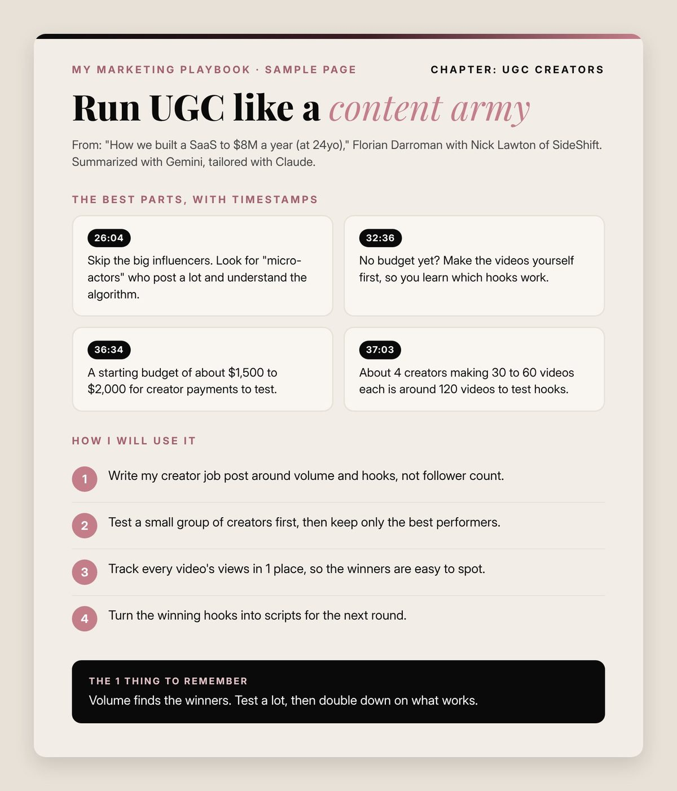

Some of the best business advice I have ever gotten came from a YouTube video. The problem? Most of those videos are 1 or 2 hours long, and I watch so many that I forget half of what I learned by Friday.

So I built a system. Every week I watch the newest founder interviews from Starter Story and Superwall, and Gemini helps me turn the best ones into my own marketing playbook.

So, how do you summarize YouTube videos with Gemini? **Open the video on YouTube, tap the Ask button under it (the little star icon), and tap "Summarize the video." Gemini gives you the main points with clickable timestamps. For a full step by step plan, paste the video link into Gemini and ask it to pull out every strategy.** That is the whole idea. The details below are what make it useful.

Here is my exact system, a live demo of it working, and the prompts I use.

**Key takeaways:**

- The Ask button on YouTube summarizes a video in seconds, with timestamps you can tap.
- You can ask follow-up questions about the video, like "What did he say about paying creators?"
- Gemini can turn a long video into a step by step plan you save as a PDF.
- Claude then tailors that plan to your business, so you know exactly what to do next.

## Why I summarize YouTube videos with Gemini

I learn almost everything by asking AI. I am not a school person, but give me a topic I love and I will spend 13 hours on it.

YouTube is my classroom. I watch app founders explain how they grew, mostly on [Starter Story](https://www.youtube.com/@starterstory) and Superwall. And a lot of them say the same thing: run a creator program, get lots of short videos made, and find what goes viral.

But here is the honest part. I watch so many videos that I forget them. A great idea from Tuesday is gone by the weekend. That is why I started turning videos into PDFs I can go back to.

Why Gemini? Gemini is made by Google, and Google owns YouTube. So it is built right into the YouTube app and website. It is the tool I trust for this job.

## The video that changed how I find creators

For this post, I am using a real video: Florian Darroman's interview with Nick Lawton, the cofounder of SideShift. It is 51 minutes long. Press play if you want to watch it with me.

<iframe src="https://www.youtube-nocookie.com/embed/rG4X7vQuWWs" title="How we built a SaaS to $8M a year (at 24yo), Florian Darroman with Nick Lawton of SideShift" loading="lazy" allow="accelerometer; clipboard-write; encrypted-media; gyroscope; picture-in-picture; web-share" allowfullscreen style="width:100%;aspect-ratio:16/9;height:auto;border:0;display:block;margin:28px 0 10px;border-radius:16px;box-shadow:0 8px 24px rgba(10,10,10,.12);"></iframe>

*Video by [Florian Darroman](https://www.youtube.com/@asyncr0ne), shared from YouTube. All credit to him and his guest.*

Videos like this one are how I found [SideShift](https://sideshift.app), the platform I now use to hire creators for my app. Before that, I was doing cold outreach. I even hired someone to message creators for me. About 2 out of 10 answered. It was a lot of work, and it was hard to track.

SideShift changed everything. I scaled my Discord group to up to 30 creators at one point. I would never have found it if I had not been watching these videos and saving what I learned.

## Step 1: Use the Ask button to see if a video is worth it

This is the trick most people do not know about. Right under many YouTube videos, between Share and Save, there is a little star button called **Ask**. That is Gemini, built into YouTube.

When I see a video that is 1 or 2 hours long, I tap Ask first and choose "Summarize the video." In seconds, I know what it covers. If they talk about marketing that could help my business, I skip straight to the best part.

Here is the live demo, recorded in my own Chrome on this exact video:

<video src="/images/uploads/summarize-youtube-videos-with-gemini-ask-demo.mp4" poster="/images/uploads/summarize-youtube-videos-with-gemini-ask-demo-poster.jpg" autoplay muted loop playsinline controls style="width:100%;height:auto;display:block;margin:28px 0 10px;border-radius:16px;box-shadow:0 8px 24px rgba(10,10,10,.12);" aria-label="Live demo of the YouTube Ask button: tapping the star icon under the video, choosing Summarize the video, Gemini summarizing all 51 minutes with timestamps, then answering a follow-up question about paying UGC creators."></video>

*Real screen recording. Gemini summarized all 51 minutes and answered my follow-up question with exact timestamps.*

Here is how to do it:

1. **Open any video on YouTube.** It works in your computer's browser and in the YouTube app.
2. **Tap Ask under the video.** Look for the little star icon.
3. **Tap "Summarize the video."** Or type your own question in the box.
4. **Tap any blue timestamp** to jump right to that moment.
5. **Ask a follow-up question.** This is where the magic is.

Here is something surprising: the Ask button is not just on your phone and computer. Google says it also works [on smart TVs](https://support.google.com/youtube/answer/14110396?hl=en), so you can ask about a video from your couch. It only shows up on selected videos for now, so if you do not see it, try another one.

## Step 2: Ask follow-up questions, so you never rewatch

The summary is great. The follow-up questions are even better.

In my demo, I asked: "What does Nick say about how to find and pay UGC creators? Give me timestamps." Gemini answered in seconds. It said to look for "micro-actors" who post a lot, not big influencers, and it suggested a starting budget of about $1,500 to $2,000 to test creators. Every point came with the minute he said it.

Here are questions I ask almost every time:

```prompt
What are the 5 most important lessons in this video? Give me a timestamp for each one.
What does the guest say about marketing on a small budget? Give me timestamps.
What would this founder do differently if they started today?
What tools or apps does the guest mention, and what does he use each one for?
```

Copy 1, paste it into the Ask box, and you have the answer without rewatching anything. AI can still make mistakes, so I always tap the timestamp and listen to that part myself.

## Step 3: Turn the video into a step by step plan with Gemini

When a video is really good, I want more than a summary. I want a full plan I can follow and keep.

So I open [Gemini](https://gemini.google.com), paste the video link and use a prompt like this one. Fill in the brackets:

```prompt
[Paste the YouTube link]
Watch this video and pull out every marketing strategy. Do not leave anything out. Turn it into a step by step marketing plan I can use for [your business], with a timestamp for each step. Format it as a simple rulebook I can save as a PDF.
```

Gemini makes a simple plan with everything in it. I save it as a PDF, and it goes into my folder of video notes.

**If Gemini says it cannot watch the video:** this happened to me while making this post, even after I turned on the YouTube connector in Gemini's settings. Here is the fix Gemini itself suggested. On YouTube, click **...more** under the video, then **Show transcript**. Copy the whole transcript, paste it into Gemini and use the same prompt. Or go back to the Ask button, which worked perfectly in my demo.

## Step 4: Make it yours with Claude

This is my favorite step. A plan made for someone else's business is only half useful. So I take the PDF to [Claude](https://claude.ai) and ask it to translate everything into my niche.

```prompt
Here is a marketing plan from a founder video. Read every step. Now rewrite it for my business: [what you sell and who you sell to]. Tell me exactly what to do first, second and third, what to skip, and what it will cost. Keep it simple and in my own words.
```

Claude tailors it specifically for me. Now I do not just know what worked for him. I know exactly what to do in my business, and how to do it.

Then Claude adds it to my marketing playbook in my branding. Here is what I mean by "making it mine":

<video src="/images/uploads/summarize-youtube-videos-with-gemini-workflow.mp4" poster="/images/uploads/summarize-youtube-videos-with-gemini-workflow-poster.jpg" autoplay muted loop playsinline controls style="width:100%;height:auto;display:block;margin:28px 0 10px;border-radius:16px;box-shadow:0 8px 24px rgba(10,10,10,.12);" aria-label="Animated graphic of my video to playbook system: 1 find the video on YouTube, 2 check it with the Ask button, 3 pull the plan with Gemini, 4 make it mine with Claude, 5 keep it in my marketing playbook."></video>

If you want to know which AI is best for which job, here is my honest take on [Claude vs ChatGPT](https://lisahaven.co/blog/claude-vs-chatgpt/).

## How I build my own marketing playbook

Here is the part that changed my business. I do not keep 1 PDF per video. I keep 1 book.

There is not just 1 way to market a business. There is Reddit marketing, Meta ads, creator programs, email, and so much more. So I pick the strategies I find the most interesting and the most complete, from many different videos, and I mix them into my own playbook. When a new strategy comes in, it gets its own chapter.

Here is a sample page, so you can see the idea. This one is built from the SideShift video above:



*Sample page only. My real playbook stays private.*

If you run a creator program too, here is how I [manage UGC creators with AI](https://lisahaven.co/blog/how-to-manage-ugc-creators-with-ai/), and how I started [building a UGC creator program before launch](https://lisahaven.co/blog/how-to-build-ugc-creator-program-before-launch/).

## Ask button, Gemini or Claude: which one when?

| What you want | Use this | Why |
|---|---|---|
| Is this video worth my time? | YouTube Ask button | A summary in seconds, right under the video |
| 1 exact answer from the video | YouTube Ask button | Follow-up questions with timestamps |
| A full step by step plan | Gemini | Pulls out every strategy and saves as a PDF |
| A plan made for my business | Claude | Tailors every step to my niche, in my voice |

## Tools I use for this

*Some links below may be affiliate links, which means I may earn a small commission at no extra cost to you. I only share tools I really use.*

- **[YouTube](https://www.youtube.com):** my classroom, and the Ask button lives here.
- **[Gemini](https://gemini.google.com):** turns long videos into step by step plans.
- **[Claude](https://claude.ai):** tailors every plan to my business and adds it to my playbook.
- **[SideShift](https://sideshift.app):** the creator platform I found through these videos.

## Your next step

Pick 1 long video you saved and never finished. Tap Ask, then "Summarize the video." Then paste my follow-up questions into the box. In 5 minutes you will know exactly what it says and whether to watch the rest.

Want prompts like these, written by real experts? [LUMAPROMPT.AI](https://www.lumaprompt.ai/?utm_source=lisahaven&utm_medium=blog&utm_campaign=summarize-youtube-videos-with-gemini) has you covered.

**Want my real AI routines in your inbox?** [Join The Haven](https://lisa-haven.beehiiv.com/subscribe?ref=blog-summarize-youtube-videos-with-gemini), my free weekly letter on building a life and a business with AI.

## FAQ

**Can Gemini summarize a YouTube video for free?**
Yes. Google's help page says the Ask button is for signed-in users who meet the minimum age, and it does not list a paid plan. If the Gemini app will not open a link, paste the video's transcript instead.

**Why don't I see the Ask button on YouTube?**
Google says the Ask button only appears on selected videos, in selected languages and countries, for signed-in users. Try a different video, and make sure your app is up to date.

**Can Gemini give me timestamps for a YouTube video?**
Yes. Ask for them in your prompt, like "Give me a timestamp for each point." In the Ask panel, you can tap each timestamp to jump right to that moment.

## Before you go

Tell me in the comments: **how do you learn from YouTube?** Reply A for "I watch the whole thing," B for "I skip around," or C for "I save it and never watch it." No judgment. I used to be a C. 🖤

> "Learn something every day, then use it. Knowledge you put to work is the kind that changes your life."
