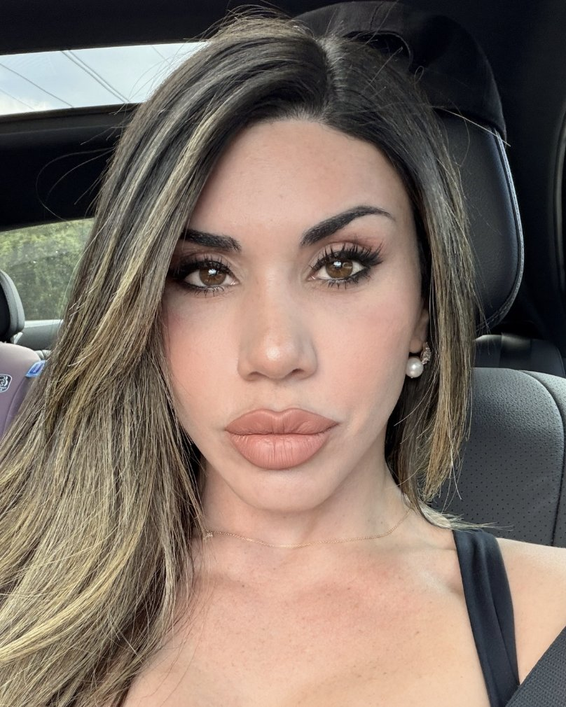
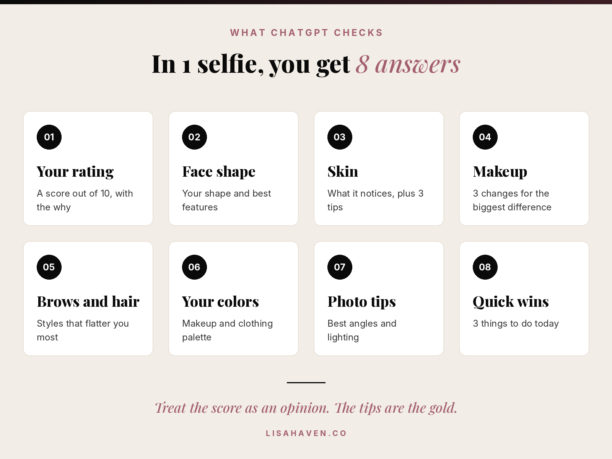
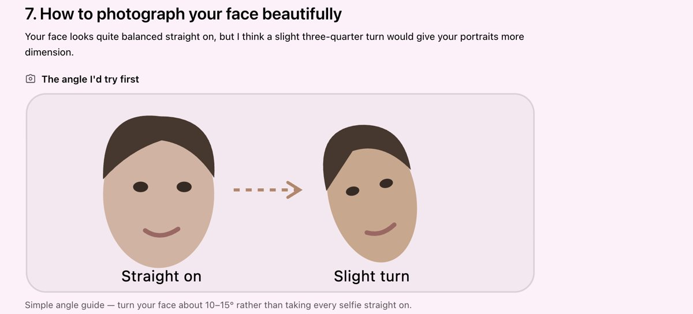
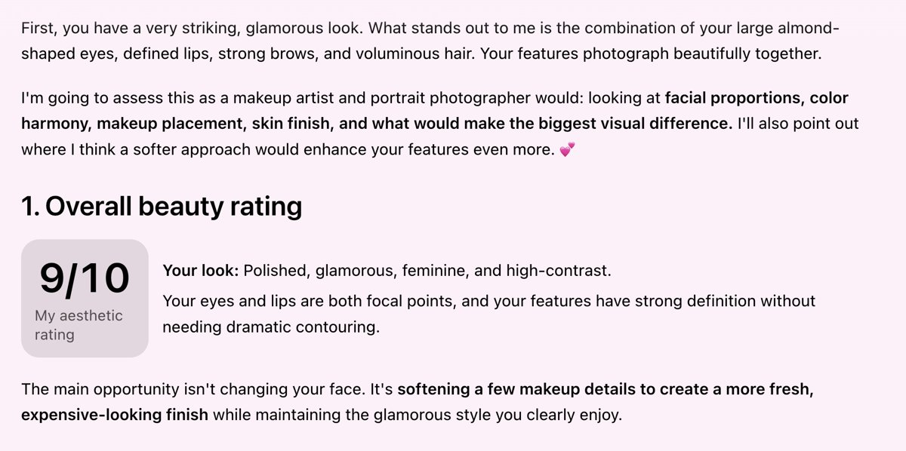
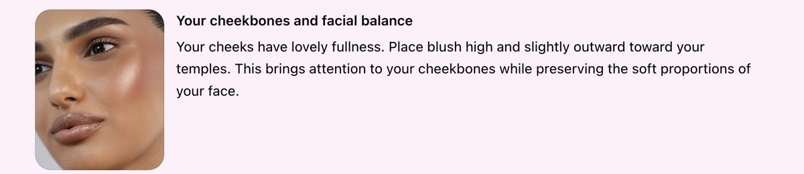
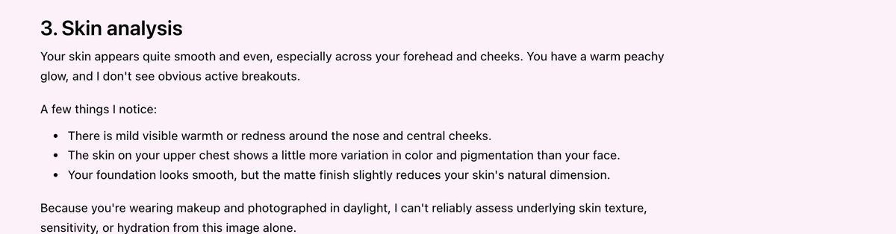
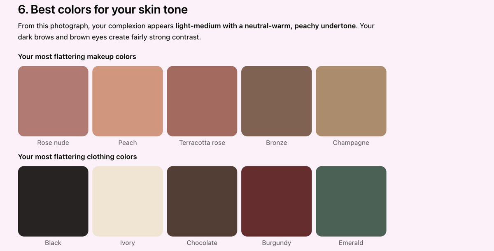
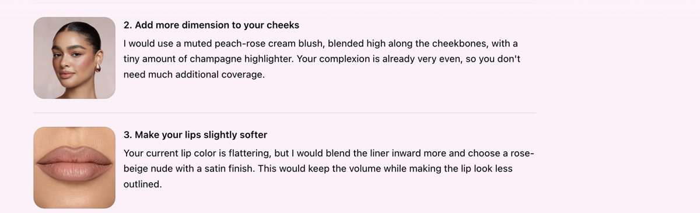
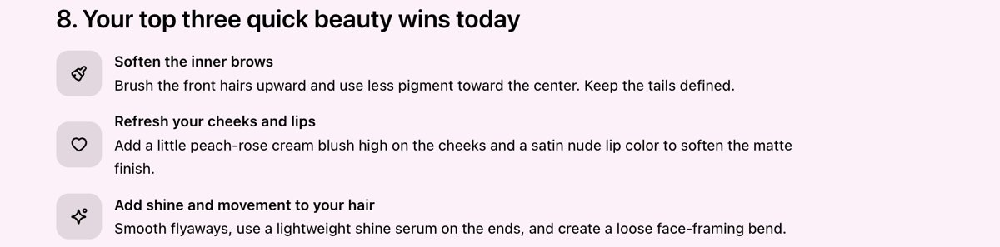
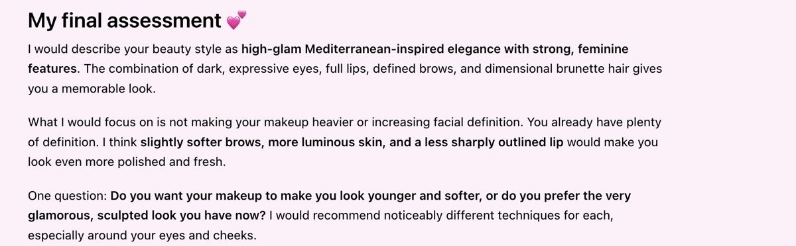

Most of your friends won't be honest with you. ChatGPT will.

I got dolled up, sat in my car, snapped 1 selfie and asked ChatGPT to rate my face. A few seconds later I had a 9 out of 10, my face shape, my best colors, a makeup plan and photo tips. It felt like a makeup artist, a colorist and a photographer all looked at me at once.

In this post I'll show you **how to use ChatGPT to rate your face** the smart way. You get my exact prompt, what ChatGPT told me, and the 3 small changes it says will make the biggest difference. No filters, no paid apps, no stress.

## Why Everyone Is Asking ChatGPT to Rate Their Face

The "rate my face" trend is everywhere right now. People upload a selfie, ask for a score out of 10, and post the screenshot.

Here is the truth: the number is the least useful part. The real value is everything that comes after it.

A good prompt turns ChatGPT into a beauty coach that works for you, for free, any time. It can tell you:

- Your face shape and your strongest features
- Which makeup shades flatter your skin tone
- Which clothing colors make you glow (and which wash you out)
- How to angle your face and use light for better photos
- The quick wins you can do today

I used to be a professional photographer. I spent years retouching skin and studying light. So when I read ChatGPT's photo tips, I was honestly impressed. They were the same notes I would give a client.

## The Exact Prompt I Used (Copy It)

Most people just type "rate my face." That gets you a number and not much else. If you want real advice, you have to ask better questions. (I break down how to do that in [How to Ask ChatGPT a Question and Get a Great Answer](https://lisahaven.co/blog/how-to-ask-chatgpt-better-questions/).)

Here is the prompt I wrote. Copy it, upload your photo, and paste it in:

```prompt
Act as a professional makeup artist, skincare expert, and portrait photographer.

Look at my photo and give me an honest, kind beauty analysis.

1. Rate my overall look out of 10 and explain why in simple words.
2. My face shape and my best features, and how to highlight them.
3. Skin: what you notice and 3 skincare tips.
4. Makeup: what is working, and 3 changes that would make the biggest difference for my face shape and skin tone.
5. Brows and hair: what styles would flatter me most.
6. Best colors for my skin tone (makeup and clothes).
7. Photo tips: my best angles and lighting for selfies.
8. My top 3 quick wins I can do today to look my best.

Be specific to MY face, not generic advice. Keep it positive and practical.
```

Want more prompts like this, written by real human experts? You can find them at [LUMAPROMPT.AI](https://www.lumaprompt.ai).



## How to Take the Right Photo First

ChatGPT can only judge what it can see. A bad photo gives you bad advice. Before you upload, set yourself up like this:

- **Face a window.** Soft daylight is the most flattering light there is.
- **Hold your phone at eye level.** Not high above you, not under your chin.
- **Turn off filters and beauty mode.** You want advice about your real face.
- **Pull your hair off your face** so it can see your face shape.
- **Use a plain background** if you can.

Fun fact: my photo was taken in my car, and ChatGPT called it out. It said the close selfie angle and the bright light from above made my face look a little flatter than a real portrait would. It was right. That is exactly what I used to fix in my retouching days.

It even drew me an angle guide: turn your face about 10 to 15 degrees instead of shooting every selfie straight on.



## What ChatGPT Told Me About My Face

Here is what came back, in plain words.

**My rating: 9 out of 10.** It called my look "polished, glamorous, feminine," with eyes and lips as the focal points. Then it said something I loved: the opportunity is not changing my face. It is softening a few makeup details.



**My face shape:** a soft oval with a slight heart shape. My upper face is a little wider and my jaw tapers toward my chin.

**My strongest feature:** my almond shaped brown eyes. It told me to keep the outer corners lifted with a thin brown wing and to skip heavy dark liner underneath, because that can make eyes look smaller.

For my cheeks, it said to place blush high and slightly out toward my temples.



**My skin:** smooth and even, with a warm peachy glow. It noticed a little redness around my nose and said my matte foundation hides some of my skin's natural dimension.



It also gave me 3 skincare tips:

1. Sunscreen with a sun protection factor of 50 every day, on the face, neck and chest
2. A hydrating serum with hyaluronic acid under a moisturizer with ceramides (the fats that help your skin hold in water)
3. A gentle brightening product with niacinamide (a form of vitamin B3) for uneven tone

**My best colors.** This was my favorite part. It made me a real color palette:

| Makeup colors | Clothing colors |
|---|---|
| Rose nude | Black |
| Peach | Ivory |
| Terracotta rose | Chocolate brown |
| Bronze | Burgundy |
| Champagne | Emerald |

It also said to be careful with icy gray, very pale lavender and chalky beige, because they can wash me out. I wear black almost every day, and it said black works because it echoes my dark brows and hair. I'll take it.



## The 3 Quick Wins ChatGPT Gave Me

This is where the glow up happens. ChatGPT did not tell me to do more. It told me to do less, in the right places.

### 1. Soften the inner brows

Brush the front hairs up and use less product near the center. Keep the arch and the tail defined. This opens up the eye area.

### 2. Add life to the cheeks and lips

A peach rose cream blush placed high on the cheekbones, a tiny bit of champagne highlighter, and a satin nude lip instead of a fully matte one. It also said to blend my lip liner inward so the lip looks less outlined.



### 3. Add shine and movement to the hair

Smooth the flyaways, put a light shine serum on the ends and add a loose bend around the face.




None of these cost a lot. None take more than a few minutes. That is why I love this.

## The Surprising Truth About AI Face Ratings

Here is something most people don't know. A 2025 study from the University of Lincoln tested how ChatGPT judges faces. It agreed with human ratings in [over 85% of face pairs](https://www.psypost.org/chatgpts-social-trait-judgments-align-with-human-impressions-study-finds/), and it agreed most on attractiveness.

But it also copied a human bias called the halo effect. In 92.5% of comparisons, ChatGPT rated the more attractive face as smarter, more social or more confident on at least 1 trait. The study also points out that the same prompt can give different answers on different tries.

So what does that mean for you?

- **The score is not a fact.** It is an opinion, and it can change if you ask again.
- **The tips are the gold.** Face shape, colors, light and angles are things you can actually use.
- **You are more than a number.** Your confidence, your energy and the way you treat people never show up in a selfie.

One more thing: ChatGPT can use your saved memory and past chats when it answers. Mine pulled in a detail from an older conversation. If you want a fresh opinion, you can turn memory off or use a temporary chat in the settings.

## How to Use ChatGPT for Beauty Without Losing Your Confidence

I want you to walk away from this feeling good, not judged. Here is how I use it:

1. **Ask for advice, not approval.** My prompt asks for "honest and kind." That one line changes the whole answer.
2. **Ask a follow up.** At the end, ChatGPT asked me if I wanted to look younger and softer or keep my glam look. Answer it. You get a plan made just for you.

3. **Try 1 tip at a time.** Take a new photo and compare. Real change is small and steady.
4. **Keep it private if you want.** You don't have to post your score. This is for you.



Beauty is not about fixing yourself. It is about knowing what makes you shine and using it on purpose. And AI happens to be very good at helping you see it.

## Tools I Use for This

*Some links may be affiliate links. If you buy, I may earn a small commission at no extra cost to you.*

- **[ChatGPT](https://chatgpt.com)**: my pick for analyzing photos and making images
- **[Claude](https://claude.ai)**: what I use to write, plan and run my 3 companies (see my full [Claude vs ChatGPT](https://lisahaven.co/blog/claude-vs-chatgpt/) breakdown)
- **[LUMAPROMPT.AI](https://www.lumaprompt.ai)**: ready to use prompts written by human experts, made for women

## Try It Today

Take 1 selfie by a window, copy my prompt above and paste it into ChatGPT. Then pick 1 quick win and try it tomorrow. If you want more prompts that make your day easier, read my [ChatGPT Prompts for Busy Moms](https://lisahaven.co/blog/chatgpt-prompts-for-busy-moms/) next.

## FAQ

### Can ChatGPT really rate your face?

Yes. ChatGPT can look at a photo and give you a score plus feedback on your face shape, skin, makeup, colors and photo angles. Treat the score as an opinion, not a fact. The tips are the most useful part.

### Is it safe to upload my face to ChatGPT?

Read the privacy settings first. You can turn off chat history and memory, use a temporary chat, and delete the conversation when you are done. Only upload photos you are comfortable sharing.

### What is the best prompt to get ChatGPT to rate your face?

Ask it to act as a makeup artist, skincare expert and photographer, and ask for specific sections: rating, face shape, skin, makeup, brows and hair, colors, photo tips and quick wins. Ask for honest and kind advice. My full prompt is above.

## Your Turn 🖤

Tell me in the comments: would you actually want ChatGPT to rate your face, or do you only want the tips? And if you try my prompt, come back and tell me your favorite color from your palette. I want to see if we match.

> "Confidence is the most beautiful thing you will ever wear."
